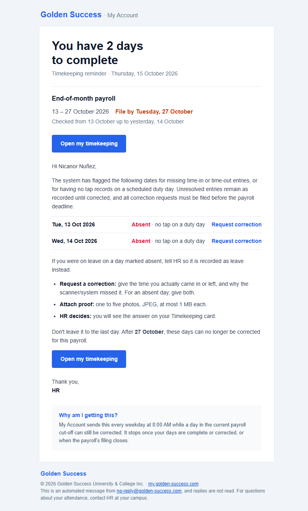

**A front-end reference guide for the Chemical suite of web applications**

Version 1.0 · Built on Bootstrap 5.3 · Bootstrap Icons 1.11+

---

## Table of contents

**Getting started**
- [Introduction](#introduction)
- [Contents](#contents)
- [Principles](#principles)

**Customize**
- [Color system](#color-system)
- [Semantic tokens](#semantic-tokens)
- [Typography scale](#typography-scale)

**Layout**
- [Grid conventions](#grid-conventions)
- [Card anatomy](#card-anatomy)
- [Spacing](#spacing)

**Content**
- [Typography](#typography)
- [Tables](#tables)

**Forms**
- [Form controls](#form-controls)
- [Floating labels](#floating-labels)
- [Search inputs](#search-inputs)
- [Form layout](#form-layout)

**Components**
- [Application bar](#application-bar)
- [Breadcrumb](#breadcrumb)
- [Page header](#page-header)
- [Stat cards](#stat-cards)
- [Stock tiles](#stock-tiles)
- [Buttons](#buttons)
- [Badges and pills](#badges-and-pills)
- [Avatars and photos](#avatars-and-photos)
- [Modals](#modals)
  - [Image viewer](#6-image-viewer)
- [Tabs](#tabs)
- [Side navigation](#side-navigation)
  - [In an application shell](#in-an-application-shell)
- [Detail rows](#detail-rows)
- [Empty states](#empty-states)
- [Loading states](#loading-states)
- [Flash messages](#flash-messages)
- [Notice cards](#notice-cards)
- [Dropdowns](#dropdowns)

**Utilities**
- [Gradient bars](#gradient-bars)
- [Icon bubbles](#icon-bubbles)
- [Section labels](#section-labels)

**Patterns**
- [Confirmation flow](#confirmation-flow)
  - [Active confirmation](#active-confirmation)
- [Selection lists](#selection-lists)
- [Figure grids](#figure-grids)
- [Grouped tables](#grouped-tables)
- [Page templates](#page-templates)
- [Migration guide](#migration-guide)

**Email**
- [Transactional email](#transactional-email)
  - [Before an email ships](#before-an-email-ships)

---

# Getting started

## Introduction

The system is built entirely on **Bootstrap 5.3** with **no custom CSS framework, no build step, and no Sass compilation**. Everything is either a Bootstrap utility class or an inline `style` attribute using hex values documented here. This is a deliberate constraint: the application runs on ASP.NET MVC with Razor views served by IIS, and adding a preprocessor to that pipeline is not worth the cost.

### What this replaces

Bootstrap's default contextual classes (`btn-primary`, `bg-danger`, `text-bg-warning`, `alert-danger`) produce high-saturation, high-contrast UI that reads as loud in a data-dense administrative application. This system replaces them with **soft tinted surfaces** — a pale background, a mid-tone border, and a saturated foreground drawn from the same hue family.

```
Bootstrap default          This system
─────────────────          ───────────
btn-primary                background #eff6ff
  solid #0d6efd fill       border    1.5px #93c5fd
  white text               color     #2563eb
```

The result is quieter, scales better when many elements share a screen, and lets genuinely urgent states (errors, destructive actions) stand out because they aren't competing with routine ones.

### Requirements

```html
<link rel="stylesheet" href="https://cdn.jsdelivr.net/npm/bootstrap@5.3.8/dist/css/bootstrap.min.css">
<link rel="stylesheet" href="https://cdn.jsdelivr.net/npm/bootstrap-icons@1.11.3/font/bootstrap-icons.css">
<script src="https://cdn.jsdelivr.net/npm/bootstrap@5.3.8/dist/js/bootstrap.bundle.min.js"></script>
```

jQuery is assumed present in payment and disbursement views (used for AJAX submission and DOM manipulation). Bootstrap's own JS is used through `data-bs-*` attributes wherever possible.

---

## Contents

The system is organized around four ideas. Everything else derives from these.

| Concept | What it is |
|---|---|
| **The card** | Every meaningful block of content lives in `card border-0 shadow-sm` with a gradient bar at the bottom |
| **The soft pill** | Every button, badge, and status indicator uses tinted background + border + matching foreground |
| **The section label** | Every card section is introduced by uppercase, letter-spaced, muted 0.70rem text with a leading icon |
| **The semantic color** | Each payment type, status, and action category owns one hue used consistently everywhere |

If you internalize those four, you can build a new page that fits the system without consulting this document again.

---

## Principles

**1. Color carries meaning, not decoration.**
Blue is not "the primary color." Blue means *cash*. Purple means *online*. Teal means *cheque*. Red means *destructive*. When you reach for a color, you are making a semantic claim. If you can't name what the color means, use slate.

**2. Never use Bootstrap's solid contextual classes.**
`btn-primary`, `btn-danger`, `bg-success`, `text-bg-warning`, `alert-danger` are all banned. They exist in Bootstrap for a general audience; this application has a specific one.

**3. Disabled states are shown, not enforced.**
A cancelled record shows a grey dashed pill, not a `disabled` button. The user should understand *why* an action is unavailable, not just discover that clicking does nothing.

**4. Every destructive action is confirmed.**
Cancel, remove, delete, validate, and save-and-print all pass through a confirmation modal that restates the data. See [Confirmation flow](#confirmation-flow).

**5. Empty states are designed.**
`No records found` as bare text is a bug. Every empty collection renders a dashed box with an icon and italic muted text.

**6. Inline styles are acceptable; inline styles that override `.active` are not.**
Because there is no build step, inline `style` attributes are the delivery mechanism. But CSS specificity means inline styles defeat class-based state changes. Any element whose appearance changes based on a Bootstrap-toggled class (`.active`, `.show`, `.collapsed`) **must** be styled from a `<style>` block. See [Tabs](#tabs).

---

# Customize

## Color system

### Payment type identity

These three colors are the backbone of the system. A cash view is blue from breadcrumb to gradient bar; an online view is purple throughout; a cheque view is teal.

| Type | Icon | Surface | Border | Foreground | Gradient |
|---|---|---|---|---|---|
| **Cash** | `bi-wallet-fill` | `#eff6ff` | `#93c5fd` | `#2563eb` | `#2563eb → #60a5fa` |
| **Online** | `bi-phone-fill` | `#fdf4ff` | `#d8b4fe` | `#9333ea` | `#9333ea → #a78bfa` |
| **Cheque** | `bi-journal-check` | `#f0fdfa` | `#99f6e4` | `#0f766e` | `#0f766e → #2dd4bf` |

Deeper tints for hover states and nested icon bubbles:

| Type | Hover surface | Bubble fill |
|---|---|---|
| Cash | `#dbeafe` | `#dbeafe` |
| Online | `#ede9fe` | `#ede9fe` |
| Cheque | `#ccfbf1` | `#ccfbf1` |

### Action colors

| Action | Surface | Border | Foreground | Gradient |
|---|---|---|---|---|
| **Create / Add** | `#f0fdf4` | `#86efac` | `#16a34a` | `#16a34a → #34d399` |
| **Edit / Primary** | `#eff6ff` | `#93c5fd` | `#2563eb` | `#2563eb → #60a5fa` |
| **Destructive** | `#fff1f2` | `#fda4af` | `#e11d48` | `#e11d48 → #fda4af` |
| **Neutral / Close** | `#f1f5f9` | `#e2e8f0` | `#475569` | — |
| **Warning / Pending** | `#fff7ed` | `#fed7aa` | `#c2410c` | `#c2410c → #fb923c` |

### Neutral scale

Drawn from Tailwind's slate family. Used for text, borders, and surfaces that carry no semantic weight.

| Token | Hex | Use |
|---|---|---|
| `slate-900` | `#1e293b` | Primary text, headings, values |
| `slate-600` | `#475569` | Body text, secondary values |
| `slate-500` | `#64748b` | Table headers, form labels, help text |
| `slate-400` | `#94a3b8` | Section labels, muted metadata, placeholder icons |
| `slate-300` | `#cbd5e1` | Empty-state icons, dashed borders, disabled text |
| `slate-200` | `#e2e8f0` | Input borders, card dividers, table header rule |
| `slate-100` | `#f1f5f9` | Neutral pill fill, table row dividers, hairline rules |
| `slate-50` | `#f8fafc` | Read-only surfaces, note boxes, empty-state fill |

---

## Semantic tokens

Quick lookup for the most common decisions.

```
Element                          Value
─────────────────────────────    ──────────────────────────────────────
Card                             border-0 shadow-sm
Card gradient bar                height: 3px, radius 0 0 0.375rem 0.375rem
Button / pill radius             8px
Badge / small pill radius        6px  (rounded pill: 20px)
Border width (interactive)       1.5px
Border width (structural)        1px
Table header rule                2px solid #e2e8f0
Table row divider                1px solid #f1f5f9
Icon bubble (standard)           34px × 34px, rounded-circle
Icon bubble (large)              40px × 40px
Icon bubble (success modal)      56px × 56px
Uniform button height            38px  (48px for full-width primary action)
Uniform button width             200px (right-rail action stacks)
```

---

## Typography scale

The system uses a compressed scale. Nothing is larger than `2rem` except a page's single hero number.

| Role | Size | Weight | Color | Notes |
|---|---|---|---|---|
| Hero number | `2rem` | `fw-bold` | semantic | Total amounts, stat counts |
| Page title | `1rem` | `fw-bold` | `#1e293b` | In page header card |
| Card heading | `1.5rem` | `fw-bold` | `#1e293b` | Record titles (`Voucher #024068`) |
| Modal title | `h6` default | `fw-bold` | `#1e293b` | |
| Value / row primary | `0.90rem` | `fw-semibold` | `#1e293b` | |
| Amount in row | `0.88rem` | `fw-bold` | semantic | |
| Body / table cell | `0.85rem` | normal | `#1e293b` / `#475569` | |
| Button label | `0.78rem` | `fw-semibold` | semantic | `letter-spacing: 0.03em` |
| Table header | `0.72rem` | `600` | `#64748b` | uppercase, `letter-spacing: 0.05em` |
| Section label | `0.70rem` | `fw-semibold` | `#94a3b8` | uppercase, `letter-spacing: 0.08em` |
| Badge / pill | `0.68rem` | `fw-semibold` | semantic | |
| Helper text | `0.75rem` | normal | `#94a3b8` | |

### Monospace

Reserved for identifiers the user may need to read character by character or copy: UUIDs, reference numbers, cheque numbers, OR numbers.

```html
<span class="font-monospace" style="color: #2563eb;">59780611-7463-499b-a872-e1d2b9130037</span>
```

---

# Layout

## Grid conventions

The system uses three layouts. Pick the one that matches your content, don't invent a fourth.

### Full width — `col-12`

Wide tables, particulars lists, anything with more than five columns.

```html
<div class="row mb-5">
    <div class="col-12">
        <!-- card -->
    </div>
</div>
```

### Detail split — `col-md-7` / `col-md-5`

Form on the left, summary and actions on the right. The standard for data-entry pages.

```html
<div class="row g-3">
    <div class="col-md-7">
        <!-- form cards -->
    </div>
    <div class="col-md-5">
        <!-- total card, action card -->
    </div>
</div>
```

### Equal split — `col-md-6` × 2

Two related but independent blocks. Always pair with `h-100` so both cards match height regardless of content.

```html
<div class="row g-3">
    <div class="col-md-6">
        <div class="card border-0 shadow-sm h-100"> ... </div>
    </div>
    <div class="col-md-6">
        <div class="card border-0 shadow-sm h-100"> ... </div>
    </div>
</div>
```

### Gutters

Always `g-3`. Never rely on per-card `mb-3` inside a row — it produces uneven vertical rhythm when cards wrap.

---

## Card anatomy

Every card follows the same skeleton:

```html
<div class="card border-0 shadow-sm mb-3">
    <div class="card-body px-4 py-3">

        <!-- 1. Section label -->
        <p class="text-uppercase fw-semibold mb-3"
           style="font-size: 0.70rem; letter-spacing: 0.08em; color: #94a3b8;">
            <i class="bi bi-info-circle-fill me-1"></i> Section Name
        </p>

        <!-- 2. Content -->

    </div>

    <!-- 3. Gradient bar -->
    <div style="height: 3px; background: linear-gradient(90deg, #2563eb, #60a5fa);
                border-radius: 0 0 0.375rem 0.375rem;"></div>
</div>
```

### Rules

- `border-0 shadow-sm` — never `border`, never `shadow` (except modals, which use `shadow`)
- `card-body px-4 py-3` for standard content; `p-2` when the body contains only a full-width button
- The gradient bar sits **outside** `card-body`, as the last child of `card`
- Gradient color must match the card's semantic meaning
- Multi-purpose cards (recent activity, action lists) use a three-stop rainbow: `linear-gradient(90deg, #2563eb, #9333ea, #0f766e)`

### Multi-section cards

Separate sections with a hairline rule, not nested cards.

```html
<div class="card-body px-4 py-3">
    <!-- Section A -->
</div>

<hr class="mx-3 my-0" style="border-color: #f1f5f9;">

<div class="px-3 py-3">
    <!-- Section B -->
</div>

<div style="height: 3px; background: ...;"></div>
```

Inside a single `card-body`, use `<hr style="border-color: #f1f5f9; margin: 1rem 0;">`.

---

## Spacing

| Context | Value |
|---|---|
| Between cards in a column | `mb-3` |
| Between rows of cards | `g-3` on the row |
| Below the last card before page end | `mb-5` |
| Card body padding | `px-4 py-3` |
| Modal body padding | `px-4 py-3` |
| Modal header padding | `border-0 pb-0 px-4 pt-4` |
| Modal footer padding | `border-0 px-4 pb-4` |
| Section label bottom margin | `mb-3` (or `mb-2` when tight) |
| Gap between stacked buttons | `gap-2` on the flex parent |
| Gap between icon and label | `gap-2` (buttons), `gap-3` (rows with bubbles) |

---

# Content

## Typography

Headings do not use `h1`–`h6` sizing defaults. Every text element carries an explicit `font-size` in its `style` attribute so that the rendered size is independent of the tag chosen.

```html
<!-- Correct: explicit size, semantic tag -->
<h4 class="fw-bold mb-0" style="font-size: 1.5rem; color: #1e293b;">
    Voucher <span style="color: #2563eb;">#024068</span>
</h4>

<!-- Wrong: relying on h4's default size -->
<h4 class="fw-bold">Voucher #024068</h4>
```

### Highlighted identifiers

When a record has a number, the label stays dark and the number takes the semantic color:

```html
<h4 class="fw-bold mb-0" style="font-size: 1.5rem; color: #1e293b;">
    Disbursement <span style="color: #2563eb;">#025037</span>
</h4>
```

---

## Tables

### Base classes

```html
<table class="table table-sm table-hover align-middle">
```

Never `table-striped` (competes with row dividers) and never `table-bordered` (too heavy).

### Header

```html
<thead>
    <tr style="border-bottom: 2px solid #e2e8f0;">
        <th style="font-size: 0.72rem; color: #64748b; font-weight: 600;
                   letter-spacing: 0.05em; text-transform: uppercase;">Column</th>
        <th style="font-size: 0.72rem; color: #64748b; font-weight: 600;
                   letter-spacing: 0.05em; text-transform: uppercase;"
            class="text-end">Amount</th>
    </tr>
</thead>
```

### Body rows

```html
<tr style="border-bottom: 1px solid #f1f5f9;">
    <td style="font-size: 0.85rem; color: #1e293b;">Value</td>
    <td class="text-end">
        <span class="fw-bold" style="font-size: 0.88rem; color: #2563eb;">₱ 1,200.00</span>
    </td>
</tr>
```

### Footer totals

```html
<tfoot>
    <tr style="border-top: 2px solid #e2e8f0; background-color: #f8fafc;">
        <th style="font-size: 0.82rem; color: #1e293b;">Total</th>
        <th class="text-end">
            <span class="fw-bold" style="color: #2563eb; font-size: 0.88rem;">₱ 99,364.04</span>
        </th>
    </tr>
</tfoot>
```

### Always wrap

```html
<div class="table-responsive">
    <table class="table table-sm table-hover align-middle"> ... </table>
</div>
```

### Ruled columns — the one exception to "never `table-bordered`"

A table read **across** as much as down needs a vertical rule, and row dividers alone do not give one. Once a table carries a row of like figures under separate headings — a grade per term, a total per month — the eye has to get from a number back to the column it belongs to, and with eight columns it cannot.

This is still not `table-bordered`: that rules the table's outer edge as well and uses Bootstrap's heavier default colour. `.cc-ruled` is one hairline in the same slate the row dividers use.

```css
.cc-ruled {
    border-collapse: collapse;
    border-spacing: 0;
}

.cc-ruled th,
.cc-ruled td {
    border: 1px solid #e2e8f0;
}
```

```html
<table class="table table-sm table-hover align-middle cc-ruled">
```

**It lives in the stylesheet, not inline**, and it is the case that shows why the inline-first rule has a limit: this is one declaration applied to every cell in the table, and forty inline copies of it is how a single cell ends up without one — a gap in the grid that reads as a rendering fault.

**Reach for it only when the columns are being compared.** A list of records with a name, a status and an action is read down; ruling it adds noise and buys nothing.

### Uniform figure columns

Columns holding the same kind of number are pinned to one width rather than each sizing to its own heading. Without it, `Final` is narrower than `Term 1` and the row of figures visibly steps in at the end.

```html
<th style="width: 4.5rem; min-width: 4.5rem; max-width: 4.5rem;" class="text-center">Term 1</th>
```

All three properties, not just `width`: on a table `width` alone is a suggestion the layout algorithm may overrule once the content asks for more. Keep the cells `font-monospace` so digits line up vertically inside the centred column.

### Currency

Amounts are always right-aligned, bold, and semantic-colored. The peso sign is separated by a single space: `₱ 1,200.00`.

### Expandable row detail

When a cell stands for a short list — every time a voucher was printed, every payment against an invoice — the cell shows the count and opens the list underneath the row, rather than sending the reader to another page or crowding the column.

```html
<td>
    <a href="#" class="cc-prints text-decoration-none" data-id="42" style="font-size: 0.78rem; color: #9333ea;">
        2 prints <i class="bi bi-chevron-down" style="font-size: 0.65rem;"></i>
    </a>
</td>
<!-- immediately after that row -->
<tr class="cc-prints-row" data-id="42" hidden>
    <td colspan="8" style="background-color: #f8fafc;">
        <div class="px-2 py-1">
            <div style="font-size: 0.78rem; color: #475569;">
                <i class="bi bi-printer me-1" style="color: #9333ea;"></i>2026-09-23 10:42 &middot; NICANOR NUÑEZ
            </div>
        </div>
    </td>
</tr>
```

- **The detail row is a sibling, not a nested table**, and its `colspan` covers every column — a short row breaks the column rules the header set.
- **The chevron turns** (`bi-chevron-down` to `bi-chevron-up`) so the control says which way it will move.
- **Nothing to show is a phrase, not an empty link:** `<span style="color:#94a3b8;">Not printed</span>`. A control that opens nothing is worse than a sentence.

---

# Forms

## Form controls

Every input, select, and textarea uses the same border treatment.

```html
style="border: 1.5px solid #e2e8f0; border-radius: 8px; font-size: 0.85rem;"
```

| Property | Value | Why |
|---|---|---|
| `border` | `1.5px solid #e2e8f0` | Matches interactive border weight elsewhere |
| `border-radius` | `8px` | Matches buttons and pills |
| `font-size` | `0.85rem` | Matches table body text |

### File inputs sit outside `form-floating`

Every other control is wrapped in a floating label. A file input must not be.

```html
<!-- correct: label above, control below -->
<label for="photo" class="form-label"
       style="font-size: 0.72rem; font-weight: 600; color: #64748b;
              letter-spacing: 0.04em; text-transform: uppercase;">
    <i class="bi bi-image"></i> ID photo
</label>
<input type="file" class="form-control" id="photo" name="Photo" accept="image/jpeg"
       style="border: 1.5px solid #e2e8f0; border-radius: 8px; font-size: 0.85rem;">
```

A floating label animates into the space *inside* the control. A file input's left portion is a
**browser-drawn button** whose size and text the page does not control, so the label lands on
top of it instead of above it — unreadable, and differently unreadable in each browser. Use a
plain `form-label` above.

**`accept` is a convenience, never a check.** It filters the picker's dialog, which the user can
defeat by typing a name, and the content type the browser then sends is a claim. Test the bytes
on the server.

A form carrying a file input needs `enctype="multipart/form-data"`. Without it the browser posts
the *filename* as a string and the server binds no file, with nothing anywhere saying why.

### Number inputs

Same treatment as text. Set `min`, `max` and `step` where the range is real — they are a
convenience for the spinner and the mobile keypad, and like `accept` they are never the
enforcement.

---

## Floating labels

All labelled inputs use `form-floating`. The label carries an icon and muted styling.

```html
<div class="form-floating mb-3">
    <input type="text" id="paid_by" class="form-control" placeholder="Payee Name"
           autocomplete="off"
           style="border: 1.5px solid #e2e8f0; border-radius: 8px; font-size: 0.85rem;">
    <label for="paid_by" style="font-size: 0.82rem; color: #64748b;">
        <i class="bi bi-person-fill me-1"></i> Payee Name
    </label>
</div>
```

The `placeholder` attribute is **required** for `form-floating` to work, even though it is never visible. Add `autocomplete="off"` to any field that should not be browser-autofilled.

### Select

```html
<div class="form-floating mb-3">
    <select class="form-select" id="bank_name"
            style="border: 1.5px solid #e2e8f0; border-radius: 8px; font-size: 0.85rem;">
        <option selected>-- SELECT BANK --</option>
        <option>BDO</option>
    </select>
    <label for="bank_name" style="font-size: 0.82rem; color: #64748b;">
        <i class="bi bi-bank me-1"></i> Bank Name
    </label>
</div>
```

The placeholder option text follows the pattern `-- SELECT [THING] --` and is the value checked against in validation.

### Common field icons

| Field | Icon |
|---|---|
| Person / payee | `bi-person-fill` |
| Date | `bi-calendar3` |
| Bank | `bi-bank` |
| Reference / cheque number | `bi-hash` |
| Receipt number | `bi-receipt` |
| Note | `bi-chat-left-text-fill` |

---

## Search inputs

**Do not use `input-group`.** Bootstrap's flexbox prevents a `display: none` child from collapsing, which breaks the rounded corner when a clear button is hidden. Use absolute positioning instead.

```html
<div style="position: relative; max-width: 320px; width: 100%;">
    <span style="position: absolute; left: 12px; top: 50%; transform: translateY(-50%);
                 z-index: 1; pointer-events: none;">
        <i class="bi bi-search" style="font-size: 0.80rem; color: #94a3b8;"></i>
    </span>
    <input type="text" class="form-control" id="uploadingSearch"
           placeholder="Search uploading..."
           style="border: 1.5px solid #e2e8f0; border-radius: 8px;
                  font-size: 0.82rem; box-shadow: none;
                  padding-left: 34px; padding-right: 32px;">
    <button type="button" id="clearUploading"
            style="display: none; position: absolute; right: 10px; top: 50%;
                   transform: translateY(-50%); border: none; background: transparent;
                   cursor: pointer; color: #94a3b8; padding: 0; line-height: 1;"
            onmouseover="this.style.color='#e11d48'"
            onmouseout="this.style.color='#94a3b8'">
        <i class="bi bi-x-circle-fill" style="font-size: 0.80rem;"></i>
    </button>
</div>
```

### Wiring

```javascript
function wireSearch(input, clearBtn, debouncedFn) {
    if (!input) return;
    input.addEventListener('input', (e) => {
        const val = e.target.value;
        debouncedFn(val);
        if (clearBtn) clearBtn.style.display = val.length > 0 ? 'block' : 'none';
    });
    if (clearBtn) {
        clearBtn.addEventListener('click', () => {
            input.value = '';
            debouncedFn('');
            clearBtn.style.display = 'none';
            input.focus();
        });
    }
}
```

Always debounce at 150 ms:

```javascript
function debounce(func, wait) {
    let timeout;
    return function (...args) {
        clearTimeout(timeout);
        timeout = setTimeout(() => func.apply(this, args), wait);
    };
}
```

---

## Form layout

### Read-only data

Never render read-only values as `disabled` inputs. Grey boxes with grey text are hard to read and imply the field is temporarily unavailable rather than permanently informational. Use a labelled row with an icon bubble:

```html
<div class="d-flex align-items-center gap-3 py-2 border-bottom">
    <div class="rounded-circle d-flex align-items-center justify-content-center flex-shrink-0"
         style="width: 34px; height: 34px; background-color: #eff6ff;">
        <i class="bi bi-pencil-fill" style="color: #2563eb; font-size: 0.80rem;"></i>
    </div>
    <div>
        <p class="mb-0 text-uppercase fw-semibold"
           style="font-size: 0.65rem; letter-spacing: 0.07em; color: #94a3b8;">Prepared By</p>
        <p class="mb-0 fw-semibold" style="font-size: 0.90rem; color: #1e293b;">@Model.prepared_by</p>
    </div>
</div>
```

### Optional text with fallback

```html
<div class="rounded px-3 py-2"
     style="background-color: #f8fafc; border: 1px dashed #e2e8f0;
            font-size: 0.875rem; color: #475569; min-height: 48px;">
    @if (!string.IsNullOrWhiteSpace(Model.note))
    {
        @Model.note
    }
    else
    {
        <span style="color: #cbd5e1; font-style: italic;">No note provided</span>
    }
</div>
```

### Validation

Validation is **flat and sequential**, never nested. Each check returns early.

```javascript
var paidBy = $('#paid_by').val().trim();
if (paidBy === '') {
    $('#modalMessage').modal('show');
    $('#lblMessage').text('The payee name field should not be left empty.');
    return;
}

var bankName = $('#bank_name option:selected').text();
if (bankName === '-- SELECT BANK --') {
    $('#modalMessage').modal('show');
    $('#lblMessage').text('Please select the bank name for this cheque.');
    return;
}

if ($('#particularsTable tbody tr').length === 0) {
    $('#modalMessage').modal('show');
    $('#lblMessage').text('Please add at least one particular before saving.');
    return;
}
```

Messages are full sentences, name the field, and end with a period.

---

# Components

## Application bar

The fixed strip across the top of every page: the application's identity on the left, the
signed-in user on the right, and nothing else.

```html
<header style="background-color: #fff; border-bottom: 1px solid #e2e8f0;">
    <div class="container-fluid px-4">
        <div class="d-flex align-items-center justify-content-between gap-3" style="height: 52px;">

            <!-- identity, and the one guaranteed way home -->
            <a href="/" class="text-decoration-none d-inline-flex align-items-center gap-2 flex-shrink-0">
                <span class="d-inline-flex align-items-center justify-content-center rounded-circle"
                      style="width: 28px; height: 28px; background-color: #eff6ff;">
                    <i class="bi bi-journal-text" style="font-size: 0.85rem; color: #2563eb;"></i>
                </span>
                <span style="font-size: 0.88rem; font-weight: 700; color: #1e293b;">Chemical Carbon</span>
            </a>

            <!-- the user menu; min-width: 0 down this chain lets a long name truncate on a phone -->
            <div class="dropdown" style="min-width: 0;">
                <a class="text-decoration-none d-inline-flex align-items-center gap-2 px-2 py-1 mw-100"
                   href="#" id="userMenu" role="button" data-bs-toggle="dropdown" aria-expanded="false"
                   title="Nicanor Nuñez" style="font-size: 0.85rem; color: #475569;">
                    <span class="d-inline-flex align-items-center justify-content-center rounded-circle flex-shrink-0"
                          style="width: 26px; height: 26px; background-color: #f1f5f9;">
                        <i class="bi bi-person-fill" style="font-size: 0.80rem; color: #64748b;"></i>
                    </span>
                    <span class="text-truncate">Nicanor Nuñez</span>
                    <i class="bi bi-chevron-down flex-shrink-0" style="font-size: 0.68rem; color: #94a3b8;"></i>
                </a>
                <ul class="dropdown-menu dropdown-menu-end shadow-sm border-0"
                    aria-labelledby="userMenu" style="min-width: 240px;">
                    <li>
                        <div class="px-3 py-2">
                            <div style="font-size: 0.70rem; font-weight: 600; text-transform: uppercase;
                                        letter-spacing: 0.08em; color: #94a3b8;">Signed in as</div>
                            <div style="font-size: 0.85rem; color: #1e293b;">name@example.com</div>
                        </div>
                    </li>
                    <li><hr class="dropdown-divider" style="border-color: #f1f5f9;"></li>
                    <li>
                        <!-- sign-out is a POST, never a link -->
                        <form method="post" action="/account/logout" class="px-2">
                            @Html.AntiForgeryToken()
                            <button type="submit" class="w-100 d-inline-flex align-items-center gap-2 px-2 py-1 border-0"
                                    style="background-color: transparent; font-size: 0.85rem; color: #475569;">
                                <i class="bi bi-box-arrow-right" style="font-size: 0.85rem;"></i> Sign out
                            </button>
                        </form>
                    </li>
                </ul>
            </div>
        </div>
    </div>
</header>
```

| | |
|---|---|
| Height | `52px`, fixed, plus its `1px` bottom border — a page measured against the bar subtracts `53px` |
| Identity bubble | 28px, the [icon bubble](#icon-bubbles) treatment in the primary tone |
| App name | `0.88rem` / `700` in the darkest neutral |
| User bubble | 26px, neutral — a person, not a status |
| Menu | `dropdown-menu-end border-0 shadow-sm`, `min-width: 240px` |

### Rules

- **It carries identity, not navigation.** Destinations belong to the side nav or to the page.
  The moment links start accumulating here it has become a navbar, and the side nav's reason to
  exist goes with it.
- **The identity is a link home.** Whatever a user has got themselves into, the top-left corner
  is the way out. It is the only navigation the bar is allowed.
- **The one control it gains is a menu button, and only on a phone.** An application whose side
  nav sits in a [shell](#in-an-application-shell) puts a `bi-list` button before the identity,
  drawn below `md` only (`d-md-none`), that opens the side nav as a drawer. It reveals the side
  nav's destinations rather than adding one, so the rule above still holds. Elsewhere nothing
  opens the side nav: a scoped workspace's nav stacks above the page on its own.
- **A long name truncates; it never widens the bar.** `min-width: 0` on the dropdown, `mw-100` on
  its trigger and `text-truncate` on the name let the name give way on a phone, where a long one
  would otherwise push the bar wider than the screen. The bubbles and the chevron carry
  `flex-shrink-0` so they keep their shape, the name moves into a `title`, and the menu's
  "Signed in as" still says it in full.
- **Sign out is a `<form method="post">` with a token, never a link.** A GET that ends a session
  is followed by the first prefetcher, link-checker or over-eager browser that meets the page —
  the same rule the [side nav's collapse toggle](#collapsible-rail) obeys, and for the same reason.
- **Role is a pill inside the menu, never on the bar.** It is a fact about the account, not a
  control, and putting it on the bar invites it to be read as a mode the user can change.
- **Environment-only items are hidden, not disabled.** A diagnostic link whose action returns
  404 outside development is a dead end wearing a label; omit it entirely where it does not work.
- **Everything past the name is inside the menu.** The bar has one job at a glance — which
  application, and who am I — and anything that needs a second glance belongs behind the chevron.

---

## Breadcrumb

Every page that is not a top-level dashboard opens with a breadcrumb card.

```html
<div class="card border-0 shadow-sm mb-3">
    <div class="card-body py-2 px-3">
        <nav aria-label="breadcrumb">
            <ol class="breadcrumb mb-0" style="font-size: 0.85rem;">
                <li class="breadcrumb-item">
                    <a href="/c/1" class="text-decoration-none"
                       style="color: #2563eb;">GSC CEBU</a>
                </li>
                <li class="breadcrumb-item">
                    <a href="/c/1/advisory" class="text-decoration-none"
                       style="color: #2563eb;">Advisory</a>
                </li>
                <li class="breadcrumb-item active" aria-current="page">
                    <span style="font-weight: 600; color: #1e293b;">GRADE 6</span>
                </li>
            </ol>
        </nav>
    </div>
</div>
```

Renders as: <code style="color:#2563eb;">GSC CEBU</code> / <code style="color:#2563eb;">Advisory</code> /
<code style="font-weight:600;color:#1e293b;">GRADE 6</code>

**Three crumbs is the typical shape**: the scope you are inside, the section within it, and the
record itself. The scope comes first because it answers "inside what?" before "which one?" —
the same question the [side navigation](#side-navigation) header answers, and the reason both
exist.

### Rules

- **`mb-0` on the `<ol>`, padding on the card body.** The `<ol>` carries a bottom margin by
  default that leaves the card looking bottom-heavy; kill it there and let `py-2 px-3` set the
  breathing room. Do **not** compensate with `pb-0` on the body — that couples the card's
  padding to a Bootstrap default you no longer control.
- **No icons in crumbs.** They compete with the page header's icon bubble directly beneath, and
  a trail is read as a path rather than scanned as a set. The header carries the iconography.
- **The divider is Bootstrap's default `/`.** Nothing overrides
  `--bs-breadcrumb-divider`; one divider across the whole application is one less thing to
  disagree about.
- **The last crumb is text, never a link**, and is the only bold one — `font-weight: 600` with
  the darkest neutral. It carries `aria-current="page"`; the others carry nothing.
- **A crumb with no destination renders as text too.** An intermediate step that exists in the
  hierarchy but has no page of its own is common — a grouping level, a scope with no index. It
  reads as part of the trail without pretending to be clickable.
- **An empty trail renders nothing at all** — no empty card, no bare divider. A page with one
  level above it has a one-crumb trail; a page with none has no card.

### What it is not

A breadcrumb states **where this page sits**, not how the reader arrived. It is built from the
hierarchy, so it is identical for two people who reached the page by different routes — never
from history, and never from a return URL. If you find yourself wanting the trail to remember a
filter or a previous screen, that is a *back* action and belongs in the page header beside the
title.

---

## Page header

Sits directly below the breadcrumb. Identifies the page with an icon bubble, title, and subtitle.

```html
<div class="card border-0 shadow-sm mb-3">
    <div class="card-body px-4 py-3">
        <div class="d-flex align-items-center gap-3">
            <div class="rounded-circle d-flex align-items-center justify-content-center"
                 style="width: 40px; height: 40px; background-color: #eff6ff;">
                <i class="bi bi-wallet-fill" style="color: #2563eb; font-size: 1rem;"></i>
            </div>
            <div>
                <p class="fw-bold mb-0" style="color: #1e293b; font-size: 1rem;">
                    Service Invoice
                </p>
                <p class="mb-0" style="font-size: 0.75rem; color: #94a3b8;
                                       text-transform: uppercase; letter-spacing: 0.07em;">
                    Non-Student · Cash Payment
                </p>
            </div>
        </div>
    </div>
    <div style="height: 3px; background: linear-gradient(90deg, #2563eb, #60a5fa);
                border-radius: 0 0 0.375rem 0.375rem;"></div>
</div>
```

Subtitle segments are joined with a middot: `Non-Student · Cash Payment`.

### Record header with actions

For detail pages showing a specific record, the header carries metadata and a right-side action stack.

```html
<div class="card border-0 shadow-sm mb-4">
    <div class="card-body px-4 py-3">
        <div class="row align-items-center">

            <div class="col">
                <div class="d-flex align-items-center gap-2 mb-1">
                    <i class="bi bi-receipt fs-4 text-secondary"></i>
                    <h4 class="fw-bold mb-0" style="color: #1e293b; font-size: 1.5rem;">
                        Disbursement <span style="color: #2563eb;">#025037</span>
                    </h4>
                </div>

                <div class="d-flex flex-wrap align-items-center gap-3 mt-1">
                    <span class="d-flex align-items-center gap-1 text-uppercase fw-semibold"
                          style="font-size: 0.82rem; letter-spacing: 0.07em; color: #64748b;">
                        <i class="bi bi-building"></i> School Advancements
                    </span>
                    <span class="text-muted" style="font-size: 0.88rem;">·</span>
                    <span class="d-flex align-items-center gap-1 text-muted"
                          style="font-size: 0.88rem;">
                        <i class="bi bi-calendar3"></i> 2026-01-07
                    </span>
                </div>

                <div class="mt-2 d-flex align-items-center gap-1 text-muted"
                     style="font-size: 0.84rem;">
                    <i class="bi bi-fingerprint" style="color: #94a3b8;"></i>
                    <span class="font-monospace" style="color: #94a3b8;">@Model.record_id</span>
                    <button class="btn btn-link btn-sm p-0 ms-1 text-muted"
                            title="Copy ID"
                            onclick="navigator.clipboard.writeText('@Model.record_id')"
                            style="font-size: 0.84rem;">
                        <i class="bi bi-copy"></i>
                    </button>
                </div>
            </div>

            <div class="col-auto d-flex flex-column align-items-end gap-2">
                <!-- action stack: see Buttons -->
            </div>

        </div>
    </div>
    <div style="height: 3px; background: linear-gradient(90deg, #c2410c, #fb923c);
                border-radius: 0 0 0.375rem 0.375rem;"></div>
</div>
```

---

## Stat cards

A row of counts or totals at the top of a dashboard. Always four across (`col-md-3`) or three across (`col-md-4`), always `h-100`.

```html
<div class="col-md-3">
    <div class="card border-0 shadow-sm h-100">
        <div class="card-body px-4 py-3">
            <p class="text-uppercase fw-semibold mb-2"
               style="font-size: 0.70rem; letter-spacing: 0.08em; color: #94a3b8;">
                <i class="bi bi-shield-fill-check me-1"></i> OR Validation
            </p>
            <h3 class="fw-bold mb-0" style="color: #c2410c; font-size: 2rem;">
                @Model.or_validation_count
            </h3>
            <small style="font-size: 0.75rem; color: #94a3b8;">Pending validations</small>
        </div>
        <div style="height: 3px; background: linear-gradient(90deg, #c2410c, #fb923c);
                    border-radius: 0 0 0.375rem 0.375rem;"></div>
    </div>
</div>
```

### With a divider variant

For stat cards that pair a number with a supporting line:

```html
<div class="card-body px-4 py-3">
    <p class="text-uppercase fw-semibold mb-1"
       style="font-size: 0.70rem; letter-spacing: 0.08em; color: #94a3b8;">
        <i class="bi bi-cash-coin me-1"></i> Total Amount
    </p>
    <h4 class="fw-bold mb-0" style="color: #2563eb; font-size: 1.6rem;">₱2,050.00</h4>
    <div class="mt-2 pt-2 border-top">
        <small class="text-muted">
            <i class="bi bi-arrow-up-circle-fill text-success me-1"></i>
            Current request total
        </small>
    </div>
</div>
```

### With a detail link

When the count has a page behind it — the records it counts, or the list it is a count of — a small arrow in the top-right corner, beside the label, opens it. The card itself stays unclickable; the number is for reading.

```html
<div class="card-body px-4 py-3">
    <div class="d-flex align-items-start justify-content-between gap-2">
        <p class="text-uppercase fw-semibold mb-2"
           style="font-size: 0.70rem; letter-spacing: 0.08em; color: #94a3b8;">
            <i class="bi bi-shield-fill-check me-1"></i> OR Validation
        </p>
        <a href="/gsc-cebu/payments/validations" class="cc-settings-link text-decoration-none"
           title="Open pending validations" hidden
           style="color: #94a3b8; font-size: 0.80rem; line-height: 1;"><i class="bi bi-box-arrow-up-right"></i></a>
    </div>
    <h3 class="fw-bold mb-0" style="color: #c2410c; font-size: 2rem;">3243</h3>
    <small style="font-size: 0.75rem; color: #94a3b8;">Pending validations</small>
</div>
```

- **`bi-box-arrow-up-right`, slate, `0.80rem`.** It is a way in, not a call to action, so it takes no colour.
- **The `title` names where it goes** — "Open pending validations", not "More".
- **Only when the reader may open the page.** Render it `hidden` and reveal it once their permission is known; an arrow to a page that refuses them advertises a door that will not open. The page itself still enforces the permission.

---

## Stock tiles

A grid of things that can be handed out, each showing what is left of it. A tile is one press = one item sold, so it is a **create** action: pale green surface, `1.5px #86efac` border, `#16a34a` figures, deepening to `#dcfce7` on hover. The name and price sit left, the count left in stock sits right.

```html
<div class="col-12 col-sm-6">
    <button type="button" class="wifi-plan d-flex align-items-center justify-content-between px-3 py-2 rounded w-100 text-start"
            data-minutes="60"
            style="background-color: #f0fdf4; border: 1.5px solid #86efac; cursor: pointer; min-height: 58px;"
            onmouseover="this.style.backgroundColor='#dcfce7'" onmouseout="this.style.backgroundColor='#f0fdf4'">
        <div>
            <p class="fw-bold mb-0" style="font-size: 0.85rem; color: #16a34a;">1 Hour</p>
            <p class="mb-0" style="font-size: 0.72rem; color: #64748b;">₱ 5.00</p>
        </div>
        <div class="text-end">
            <p class="fw-bold mb-0" style="font-size: 0.92rem; color: #16a34a;">125</p>
            <p class="mb-0" style="font-size: 0.68rem; color: #94a3b8;">Vouchers left</p>
        </div>
    </button>
</div>
```

**Rules**

- **The count is the point.** It is the tile's only figure in the semantic colour; the price stays slate, because the price is a label and the count is a state.
- **`col-12 col-sm-6`,** so four tiles are 2×2 on a card and one column on a phone. Fix `min-height` on every tile: a tile that runs out must not change the grid's height.
- **Nothing left is not a disabled button** — it is the dashed [unavailable state](#unavailable-state), in the same footprint, saying what has happened rather than offering a press that will fail. The API still refuses the sale; the tile only keeps the card honest.

```html
<div class="col-12 col-sm-6">
    <div class="d-flex align-items-center justify-content-between px-3 py-2 rounded w-100"
         style="background-color: #f1f5f9; border: 1.5px dashed #cbd5e1; min-height: 58px;">
        <div>
            <p class="fw-semibold mb-0" style="font-size: 0.85rem; color: #94a3b8;">1 Hour</p>
            <p class="mb-0" style="font-size: 0.72rem; color: #94a3b8;">₱ 5.00</p>
        </div>
        <div class="text-end">
            <p class="fw-semibold mb-0" style="font-size: 0.72rem; color: #94a3b8;">
                <i class="bi bi-x-circle-fill me-1"></i>Sold out
            </p>
        </div>
    </div>
</div>
```

### A balance and the action that empties it

Money held until somebody takes it out reads as a hero figure with its action beside it, and the history of both behind arrows. The figure carries the colour of what it is (green: money taken in); the action that moves it out is **pending orange** (`#fff7ed` / `#fed7aa` / `#c2410c`) — it is neither a create nor a destruction, and it wants a confirmation.

```html
<div class="d-flex flex-wrap align-items-end justify-content-between gap-3">
    <div>
        <p class="text-uppercase fw-semibold mb-1" style="font-size: 0.70rem; letter-spacing: 0.08em; color: #94a3b8;">
            <i class="bi bi-graph-up-arrow me-1"></i> Total Sales
            <a href="/gsc-cebu/payments/wifi/purchases" class="text-decoration-none ms-1"
               title="Open WiFi purchase history" style="color: #94a3b8; font-size: 0.80rem;"><i class="bi bi-box-arrow-up-right"></i></a>
        </p>
        <h2 id="wifiBalance" class="fw-bold mb-0" style="color: #16a34a; font-size: 2rem;">₱ 1,150.00</h2>
    </div>
    <div class="d-flex align-items-center gap-2">
        <button type="button" id="btnWifiWithdraw" class="btn cc-btn-orange d-inline-flex align-items-center gap-2 px-3 py-2">
            <i class="bi bi-cash-stack" style="font-size: 0.95rem;"></i> Withdraw
        </button>
        <a href="/gsc-cebu/payments/wifi/withdrawals" class="text-decoration-none"
           title="Open WiFi withdrawal history" style="color: #94a3b8; font-size: 0.80rem;"><i class="bi bi-box-arrow-up-right"></i></a>
    </div>
</div>
<p class="mt-1 mb-3" style="font-size: 0.75rem; color: #94a3b8;">Not yet withdrawn · 42 vouchers</p>
```

- **The arrow sits beside the action, never inside it.** A link nested in a button is invalid markup and the browser will not let both be pressed.
- **The caption says what the figure is not.** "Not yet withdrawn" tells the reader this is a running balance rather than a day's takings; without it, two totals on one dashboard read as a contradiction.
- **A zero balance says where the money went.** Once the action has emptied it, the caption names the last time it did: `Last withdrawn ₱ 135.00 on 24 Sep 2026, 11:29 AM by Maria Santos.` A bare "Nothing to withdraw" beside sales the cashier knows they made reads as money gone missing. Only a balance that has never been emptied says "Nothing to withdraw yet."
- **Nothing to take out disables the action** rather than hiding it, so the card keeps its shape all day.

### `hidden` loses to a display utility

An element that carries both the `hidden` attribute and `d-flex` stays on screen: `.d-flex` is `display: flex !important`, and `hidden` is only a user-agent rule. Paging bars, banners and toolbars are the usual victims, because those are the ones written as flex rows and toggled from script.

```css
/* Put the attribute back in charge, for the whole page or one card. */
[hidden] { display: none !important; }
```

Add this to any view whose script toggles `hidden` on a flex row. The alternative — swapping `d-none` for `d-flex` in script — also works, but every toggle then has to remember two classes, and the first one forgotten is a bar that will not go away.

---

## Buttons

### Anatomy

```html
<button type="button"
        class="btn fw-semibold d-inline-flex align-items-center gap-2 px-3 py-2"
        style="background-color: [SURFACE]; color: [FOREGROUND]; border: 1.5px solid [BORDER];
               border-radius: 8px; font-size: 0.78rem; letter-spacing: 0.03em;
               transition: all 0.2s ease;">
    <i class="bi bi-[ICON]" style="font-size: 0.95rem;"></i>
    Label
</button>
```

Icon size is **always** `0.95rem` for standard buttons and `0.70rem` for table-inline buttons. Never `20px` — it dwarfs the label.

### Variants

| Purpose | Surface | Border | Foreground | Icon |
|---|---|---|---|---|
| Add / Create | `#f0fdf4` | `#86efac` | `#16a34a` | `bi-plus-circle-fill` |
| Edit | `#eff6ff` | `#93c5fd` | `#2563eb` | `bi-pencil-fill` |
| Upload | `#eff6ff` | `#93c5fd` | `#2563eb` | `bi-cloud-arrow-up-fill` |
| Save | `#eff6ff` | `#93c5fd` | `#2563eb` | `bi-floppy2-fill` |
| Print | `#fdf4ff` | `#d8b4fe` | `#9333ea` | `bi-printer-fill` |
| Validate | `#fdf4ff` | `#d8b4fe` | `#9333ea` | `bi-check-square-fill` |
| Re-print | `#f0fdf4` | `#86efac` | `#16a34a` | `bi-printer-fill` |
| Cancel / Remove | `#fff1f2` | `#fda4af` | `#e11d48` | `bi-x-circle-fill` / `bi-trash-fill` |
| Close / Neutral | `#f1f5f9` | `#e2e8f0` | `#475569` | `bi-x-circle` |

### Hover

Bootstrap's default `.btn:hover` will fight your inline styles. Declare hover in a `<style>` block:

```css
#setCancelled:hover {
    background-color: #ffe4e6 !important;
    border-color: #f43f5e !important;
    box-shadow: 0 2px 8px rgba(225, 29, 72, 0.15);
}
```

For non-`btn` elements, inline `onmouseover` / `onmouseout` is acceptable:

```html
onmouseover="this.style.backgroundColor='#dbeafe'"
onmouseout="this.style.backgroundColor='#eff6ff'"
```

### Uniform action stacks

When buttons stack vertically in a right rail, fix both dimensions so they align:

```html
<div class="col-auto d-flex flex-column align-items-end gap-2">
    <button type="button" id="editDisbursement"
            class="btn fw-semibold d-flex align-items-center justify-content-center gap-2"
            style="background-color: #eff6ff; color: #2563eb; border: 1.5px solid #93c5fd;
                   border-radius: 8px; font-size: 0.78rem; letter-spacing: 0.03em;
                   transition: all 0.2s ease; width: 200px; height: 38px;">
        <i class="bi bi-pencil-fill" style="font-size: 0.95rem;"></i>
        Edit Disbursement
    </button>
    <!-- more buttons at the same 200 × 38 -->
</div>
```

`justify-content-center` is required — without it, content sits left inside the fixed width.

### Full-width primary action

```html
<div class="card border-0 shadow-sm mb-3">
    <div class="card-body p-2">
        <button type="button" id="submitForm"
                class="btn fw-semibold d-flex align-items-center justify-content-center gap-2 w-100"
                style="background-color: #fdf4ff; color: #9333ea; border: 1.5px solid #d8b4fe;
                       border-radius: 8px; font-size: 0.82rem; letter-spacing: 0.03em;
                       transition: all 0.2s ease; height: 48px;">
            <i class="bi bi-printer-fill" style="font-size: 0.95rem;"></i>
            Save &amp; Print
        </button>
    </div>
    <div style="height: 3px; background: linear-gradient(90deg, #9333ea, #a78bfa);
                border-radius: 0 0 0.375rem 0.375rem;"></div>
</div>
```

Note `card-body p-2` and `height: 48px` — the card is a thin frame around the button.

### Table-inline buttons

```html
<div class="d-flex flex-column gap-1">
    <button type="button"
            class="btn btn-sm fw-semibold d-flex align-items-center justify-content-center gap-1 edit-btn"
            style="background-color: #eff6ff; color: #2563eb; border: 1.5px solid #93c5fd;
                   border-radius: 6px; font-size: 0.72rem; padding: 3px 10px;">
        <i class="bi bi-pencil-fill" style="font-size: 0.70rem;"></i> Edit
    </button>
    <button type="button"
            class="btn btn-sm fw-semibold d-flex align-items-center justify-content-center gap-1 remove-btn"
            style="background-color: #fff1f2; color: #e11d48; border: 1.5px solid #fda4af;
                   border-radius: 6px; font-size: 0.72rem; padding: 3px 10px;">
        <i class="bi bi-trash-fill" style="font-size: 0.70rem;"></i> Remove
    </button>
</div>
```

Radius drops to `6px` and font to `0.72rem` at this scale.

### Icon-only buttons

Where there is no room for a word — a table-header cell, a dense toolbar — drop the label from
the face and put it on the element instead. The glyph carries the meaning; the label still has
to reach a hover and a screen reader.

```html
<a href="/reports/term-1"
   class="d-inline-flex align-items-center justify-content-center text-decoration-none"
   title="Print Term 1" aria-label="Print Term 1"
   style="background-color: #fdf4ff; color: #9333ea; border: 1.5px solid #d8b4fe;
          border-radius: 6px; padding: 2px 9px;">
    <i class="bi bi-printer-fill" style="font-size: 0.70rem;"></i>
</a>
```

Compact metrics, tighter padding: `padding: 2px 9px` against table-inline's `3px 10px`.

**Never drop the label, only move it.** `title` and `aria-label` both carry it — `title` for the
hover, `aria-label` because a button whose only content is an `<i>` has no accessible name at
all. In the unavailable state the two are joined, so the tooltip reads
`Print Term 1 — needs the Export permission` rather than losing one or the other.

Use it only where a label genuinely cannot fit. A row of unlabelled glyphs is a puzzle; one
glyph under a column heading that already names the thing is not.

### Unavailable state

A permanently unavailable action is rendered as a **dashed grey box**, not a disabled button. This communicates "this state has passed" rather than "this is temporarily broken."

```html
<div class="d-flex align-items-center justify-content-center gap-2"
     style="background-color: #f1f5f9; color: #94a3b8; border: 1.5px dashed #cbd5e1;
            border-radius: 8px; font-size: 0.78rem; font-weight: 600;
            letter-spacing: 0.03em; width: 200px; height: 38px;">
    <i class="bi bi-x-circle-fill" style="font-size: 0.95rem;"></i>
    Disbursement Cancelled
</div>
```

### In-flight state

While an AJAX request is pending, swap the icon and label, and disable every related control:

```javascript
var iconWait = '<i class="bi bi-hourglass-split" style="font-size:0.95rem;"></i>';

$("#payment_date, #paid_by, #note").prop("disabled", true);
$("#submitParticulars").prop("disabled", true);
$('#particularsTable tbody tr button').prop('disabled', true);
$("#submitForm").prop("disabled", true).html(iconWait + ' Please wait...');
```

Always pair with a `RestoreButtons()` that reverses every one of those changes on failure.

---

## Badges and pills

### Status pill (fixed-width, in an action stack)

```html
<span class="badge d-flex align-items-center justify-content-center gap-1 fw-bold"
      style="background-color: #fff7ed; color: #c2410c; border: 1.5px solid #fed7aa;
             font-size: 0.72rem; letter-spacing: 0.06em; border-radius: 6px;
             width: 200px; height: 38px;">
    <i class="bi bi-shield-fill-x" style="font-size: 0.95rem;"></i>
    NOT VALIDATED
</span>
```

### Inline pill (in a table or list row)

```html
<span class="badge fw-semibold"
      style="background-color: #eff6ff; color: #2563eb; border: 1px solid #93c5fd;
             font-size: 0.68rem; border-radius: 20px; padding: 3px 8px;">
    <i class="bi bi-wallet-fill me-1"></i>CASH
</span>
```

Border drops to `1px` and radius rises to `20px` at this scale.

### Neutral pill

```html
<span class="badge rounded-pill"
      style="background-color: #f1f5f9; color: #475569; font-size: 0.68rem; font-weight: 600;">
    CASH
</span>
```

### Status vocabulary

| Status | Surface | Border | Foreground | Icon |
|---|---|---|---|---|
| Active | `#f0fdf4` | `#86efac` | `#16a34a` | — |
| Validated | `#f0fdf4` | `#86efac` | `#16a34a` | `bi-check-circle-fill` |
| Not validated | `#fff7ed` | `#fed7aa` | `#c2410c` | `bi-shield-fill-x` |
| Cancelled | `#fff7ed` | `#fed7aa` | `#c2410c` | `bi-x-circle-fill` |
| Official Receipt | `#fff7ed` | `#fed7aa` | `#c2410c` | — |
| Service Invoice | `#f0fdf4` | `#86efac` | `#16a34a` | — |
| Archived | `#f1f5f9` | `#e2e8f0` | `#475569` | `bi-archive-fill` |
| Pending (awaiting a decision) | `#fff7ed` | `#fed7aa` | `#c2410c` | `bi-hourglass-split` |
| Approved | `#f0fdf4` | `#86efac` | `#16a34a` | `bi-check-circle-fill` |
| Denied | `#fff1f2` | `#fda4af` | `#e11d48` | `bi-x-circle-fill` |

**Archived is slate, not red.** Archiving hides a record from new work while everything that already
cites it keeps working; it is reversible, so it carries no warning colour. Pair it with Active.

A request names the action it asks for in that action's own colour:

| Request | Surface | Border | Foreground | Icon |
|---|---|---|---|---|
| Cancel | `#fff1f2` | `#fda4af` | `#e11d48` | `bi-x-circle-fill` |
| Reprint | `#fdf4ff` | `#d8b4fe` | `#9333ea` | `bi-printer-fill` |
| Edit | `#eff6ff` | `#93c5fd` | `#2563eb` | `bi-pencil-fill` |

### Unavailable pill

The dashed grey treatment the [unavailable button](#unavailable-state) uses, applied to a pill.
Use it where a *status* is the thing being withheld rather than an action — a row that cannot be
archived, a record that cannot be picked.

```html
<span class="d-inline-flex align-items-center gap-1"
      style="background-color: #f1f5f9; color: #94a3b8; border: 1.5px dashed #cbd5e1;
             border-radius: 20px; padding: 3px 10px; font-size: 0.68rem; font-weight: 600;"
      title="The current school year cannot be archived.">
    <i class="bi bi-lock"></i> In use
</span>
```

**The reason travels with it in a `title`.** A greyed pill with no explanation is indistinguishable
from a broken one — the sentence is the whole value of showing it rather than hiding it, which is
the same argument the unavailable button makes.

### Truncating

Free-text pills (particulars, descriptions) need a max width:

```html
<span class="badge fw-semibold text-truncate"
      style="background-color: #f1f5f9; color: #475569; font-size: 0.68rem;
             border-radius: 20px; padding: 3px 8px; max-width: 120px;">
    @Model.particulars
</span>
```

---

## Avatars and photos

A person's portrait in a fixed circle, falling back to an [icon bubble](#icon-bubbles) when
there is no image. Used in record headers, roster rows and pickers.

```html
<!-- with a photo -->
<span class="rounded-circle d-inline-block flex-shrink-0"
      style="width: 40px; height: 40px; overflow: hidden;">
    
</span>

<!-- without one — the icon bubble, same diameter -->
<div class="rounded-circle d-flex align-items-center justify-content-center flex-shrink-0"
     style="width: 40px; height: 40px; background-color: #f1f5f9;"
     title="No photo on file.">
    <i class="bi bi-person-fill" style="color: #94a3b8; font-size: 1rem;"></i>
</div>
```

| Size | Icon fallback | Use |
|---|---|---|
| 32px | `0.80rem` | Picker rows, dense lists |
| 40px | `1rem` | Roster rows, table cells |
| 96px | `2.4rem` | Record header |
| 150 × 180 | — | Printed documents (a rectangle, not a circle) |

### Three rules, each of which cost a bug to learn

**Clip on the wrapper, never on the ``.** An `img` is `display: inline`, and a *broken*
one is sized by the browser to its **alt text** — 178px wide instead of 40, shoving the header
sideways in exactly the case the reserved box exists for. `overflow: hidden` on the image does
not clip that, because a replaced element paints its own fallback. A fixed-size wrapper with
`overflow: hidden` solves both, so `alt=""` and let the wrapper hold the shape.

**Decide on the server, not with `onerror`.** Emit no `` at all when the server already
knows there is no image. A JavaScript error handler makes the fallback depend on a script
having run, and the broken-image flash happens first regardless.

**Version the URL when the address is stable.** If the endpoint is `/students/9/photo` whatever
the photo is, a replacement is invisible for the whole cache window — the browser never asks,
so an `ETag` is never consulted. Append a token that changes when the file does (its modified
time). Build the versioned URL in one place so a caller cannot forget it.

`object-fit: cover` is what keeps a portrait from distorting into the square; `flex-shrink-0`
is required inside any flex row, as with icon bubbles.

---

## Modals

There are **six** modal variants (plus the navigation modal, a form modal holding links). Do not invent a seventh.

All share:

```html
<div class="modal-dialog modal-dialog-centered">
    <div class="modal-content border-0 shadow">
```

`modal-dialog-centered` always. `shadow`, not `shadow-sm`. And every modal ends with a gradient bar as the last child of `modal-content`.

### 1. Success

No header, no footer. Icon bubble → title → message → single action.

```html
<div class="modal fade" id="modalSuccessPayment" data-bs-backdrop="static"
     data-bs-keyboard="false" tabindex="-1" aria-hidden="true">
    <div class="modal-dialog modal-dialog-centered">
        <div class="modal-content border-0 shadow">
            <div class="modal-body text-center px-4 py-5">
                <div class="rounded-circle d-inline-flex align-items-center justify-content-center mb-3"
                     style="width: 56px; height: 56px; background-color: #f0fdf4;">
                    <i class="bi bi-check-circle-fill" style="font-size: 1.6rem; color: #16a34a;"></i>
                </div>
                <h5 class="fw-bold mb-1" style="color: #1e293b;">Payment Saved</h5>
                <p class="mb-4" style="font-size: 0.85rem; color: #64748b;">
                    The official receipt has been saved successfully.
                </p>
                <a href="/@TempData["LocalityName"].ToString()/payments"
                   class="btn fw-semibold d-inline-flex align-items-center gap-2 px-4 py-2"
                   style="background-color: #eff6ff; color: #2563eb; border: 1.5px solid #93c5fd;
                          border-radius: 8px; font-size: 0.82rem;">
                    <i class="bi bi-arrow-left-circle-fill"></i> Back to Payments
                </a>
            </div>
            <div style="height: 3px; background: linear-gradient(90deg, #16a34a, #34d399);
                        border-radius: 0 0 0.375rem 0.375rem;"></div>
        </div>
    </div>
</div>
```

Success modals are **always** `data-bs-backdrop="static"` — the user must acknowledge and navigate, not dismiss into an already-submitted form.

### 2. Notice / Error

No header. Body is a horizontal icon bubble + text block. Footer has one neutral close button.

```html
<div class="modal fade" id="modalMessage" tabindex="-1" aria-hidden="true">
    <div class="modal-dialog modal-dialog-centered">
        <div class="modal-content border-0 shadow">
            <div class="modal-body px-4 py-4">
                <div class="d-flex align-items-start gap-3">
                    <div class="rounded-circle d-flex align-items-center justify-content-center flex-shrink-0"
                         style="width: 38px; height: 38px; background-color: #fff1f2;">
                        <i class="bi bi-exclamation-circle-fill" style="color: #e11d48; font-size: 1rem;"></i>
                    </div>
                    <div>
                        <p class="fw-semibold mb-1" style="color: #1e293b; font-size: 0.92rem;">Notice</p>
                        <p id="lblMessage" class="mb-0" style="color: #64748b; font-size: 0.85rem;">Message</p>
                    </div>
                </div>
            </div>
            <div class="modal-footer border-0 pt-0 px-4 pb-4">
                <button type="button"
                        class="btn fw-semibold d-inline-flex align-items-center gap-2 px-3 py-2"
                        data-bs-dismiss="modal"
                        style="background-color: #f1f5f9; color: #475569; border: 1.5px solid #e2e8f0;
                               border-radius: 8px; font-size: 0.78rem;">
                    <i class="bi bi-x-circle"></i> Close
                </button>
            </div>
            <div style="height: 3px; background: linear-gradient(90deg, #e11d48, #fda4af);
                        border-radius: 0 0 0.375rem 0.375rem;"></div>
        </div>
    </div>
</div>
```

Notice modals are dismissible — no `static` backdrop.

### 3. Form

Header with icon bubble + title + `btn-close`. Body with floating-label inputs. Footer with Cancel + Confirm.

```html
<div class="modal fade" id="exampleModal" tabindex="-1"
     data-bs-backdrop="static" data-bs-keyboard="false" aria-hidden="true">
    <div class="modal-dialog modal-dialog-centered">
        <div class="modal-content border-0 shadow">
            <div class="modal-header border-0 pb-0 px-4 pt-4">
                <div class="d-flex align-items-center gap-2">
                    <div class="rounded-circle d-flex align-items-center justify-content-center"
                         style="width: 34px; height: 34px; background-color: #f0fdf4;">
                        <i class="bi bi-plus-circle-fill" style="color: #16a34a; font-size: 0.85rem;"></i>
                    </div>
                    <h6 class="fw-bold mb-0" style="color: #1e293b;">Add Particular</h6>
                </div>
                <button type="button" class="btn-close" data-bs-dismiss="modal" aria-label="Close"></button>
            </div>
            <div class="modal-body px-4 py-3">
                <!-- form-floating fields -->
            </div>
            <div class="modal-footer border-0 px-4 pb-4">
                <button type="button"
                        class="btn fw-semibold d-inline-flex align-items-center gap-2 px-3 py-2"
                        data-bs-dismiss="modal"
                        style="background-color: #f1f5f9; color: #475569; border: 1.5px solid #e2e8f0;
                               border-radius: 8px; font-size: 0.78rem;">
                    <i class="bi bi-x-circle"></i> Cancel
                </button>
                <button type="button"
                        class="btn fw-semibold d-inline-flex align-items-center gap-2 px-3 py-2"
                        onclick="addRow()" data-bs-dismiss="modal"
                        style="background-color: #f0fdf4; color: #16a34a; border: 1.5px solid #86efac;
                               border-radius: 8px; font-size: 0.78rem;">
                    <i class="bi bi-check-circle-fill"></i> Add
                </button>
            </div>
            <div style="height: 3px; background: linear-gradient(90deg, #16a34a, #34d399);
                        border-radius: 0 0 0.375rem 0.375rem;"></div>
        </div>
    </div>
</div>
```

### 4. Confirmation

Same shell as the form modal but **no `btn-close`** — the user must make an explicit choice. Body restates the submitted data in read-only blocks.

```html
<div class="modal fade" id="modalConfirmPayment" data-bs-backdrop="static"
     data-bs-keyboard="false" tabindex="-1" aria-hidden="true">
    <div class="modal-dialog modal-dialog-centered">
        <div class="modal-content border-0 shadow">
            <div class="modal-header border-0 pb-0 px-4 pt-4">
                <div class="d-flex align-items-center gap-2">
                    <div class="rounded-circle d-flex align-items-center justify-content-center"
                         style="width: 34px; height: 34px; background-color: #eff6ff;">
                        <i class="bi bi-shield-fill-check" style="color: #2563eb; font-size: 0.85rem;"></i>
                    </div>
                    <h6 class="fw-bold mb-0" style="color: #1e293b;">Confirm Payment Details</h6>
                </div>
            </div>
            <div class="modal-body px-4 py-3">
                <p style="font-size: 0.80rem; color: #64748b;" class="mb-3">
                    Please review the details below before saving.
                </p>

                <!-- Read-only detail block -->
                <div class="rounded p-3 mb-3" style="background-color: #f8fafc; border: 1px solid #e2e8f0;">
                    <div class="d-flex justify-content-between align-items-center mb-2">
                        <span style="font-size: 0.70rem; text-transform: uppercase;
                                     letter-spacing: 0.07em; color: #94a3b8; font-weight: 600;">
                            Payee Name
                        </span>
                        <span id="confirm_paid_by" class="fw-semibold"
                              style="font-size: 0.88rem; color: #1e293b;"></span>
                    </div>
                </div>

                <!-- Optional block, hidden by default -->
                <div id="confirm_note_row" class="rounded p-3 mb-3"
                     style="background-color: #f8fafc; border: 1px dashed #e2e8f0; display: none;">
                    <div class="d-flex justify-content-between align-items-center">
                        <span style="font-size: 0.70rem; text-transform: uppercase;
                                     letter-spacing: 0.07em; color: #94a3b8; font-weight: 600;">Note</span>
                        <span id="confirm_note"
                              style="font-size: 0.85rem; color: #64748b; font-style: italic;"></span>
                    </div>
                </div>

                <!-- Itemized list -->
                <p style="font-size: 0.70rem; text-transform: uppercase; letter-spacing: 0.07em;
                          color: #94a3b8; font-weight: 600;" class="mb-2">Particulars</p>
                <div id="confirm_particulars_list" class="mb-3"></div>

                <!-- Total, semantic color -->
                <div class="d-flex justify-content-between align-items-center px-3 py-2 rounded"
                     style="background-color: #eff6ff; border: 1.5px solid #93c5fd;">
                    <span class="fw-semibold" style="font-size: 0.82rem; color: #2563eb;">Total Amount</span>
                    <span id="confirm_total" class="fw-bold" style="font-size: 1.1rem; color: #2563eb;"></span>
                </div>
            </div>
            <div class="modal-footer border-0 px-4 pb-4">
                <button type="button" id="btnCancelConfirm"
                        class="btn fw-semibold d-inline-flex align-items-center gap-2 px-3 py-2"
                        data-bs-dismiss="modal"
                        style="background-color: #f1f5f9; color: #475569; border: 1.5px solid #e2e8f0;
                               border-radius: 8px; font-size: 0.78rem;">
                    <i class="bi bi-pencil-fill"></i> Go Back &amp; Edit
                </button>
                <button type="button" id="btnConfirmAndSave"
                        class="btn fw-semibold d-inline-flex align-items-center gap-2 px-3 py-2"
                        style="background-color: #eff6ff; color: #2563eb; border: 1.5px solid #93c5fd;
                               border-radius: 8px; font-size: 0.78rem; transition: all 0.2s ease;">
                    <i class="bi bi-floppy2-fill"></i> Confirm &amp; Save
                </button>
            </div>
            <div style="height: 3px; background: linear-gradient(90deg, #2563eb, #60a5fa);
                        border-radius: 0 0 0.375rem 0.375rem;"></div>
        </div>
    </div>
</div>
```

The cancel label is **"Go Back & Edit"**, never "Cancel" — the user is not abandoning the record, they are returning to it.

### 5. Read-only form modal

A form modal that **reads** rather than writes — choosing which of several documents to
download, which report to open. Structurally identical to the form modal above, with two
differences that both follow from the method.

```html
<form method="get" action="/students/9/report-card" id="exportForm">
    <!-- no antiforgery token: see below -->
    <div class="form-floating">
        <select class="form-select" id="kind" name="kind">
            <option value="temporary" selected>Temporary progress report card</option>
            <option value="official">Official progress report card</option>
        </select>
        <label for="kind"><i class="bi bi-file-earmark-text"></i> What to print</label>
    </div>
</form>
```

**`method="get"`, and therefore no antiforgery token.** A GET serialises every input into the
query string — the token would sit in the URL, where it looks like a bug, gets copied into
support tickets, and protects nothing, because there is no state to forge when the request only
reads. This is the one form in the system that omits it; every other modal writes and carries it.

The payoff is a **bookmarkable, sendable result URL**. That is the test for whether a modal
belongs in this variant: if the outcome is worth linking to, it is a GET.

| | Write modal | Read modal |
|---|---|---|
| Method | `post` | `get` |
| Antiforgery token | Required | Omitted |
| Confirm label | The verb — `Save changes` | The artefact — `Download PDF` |
| Result | A flash and a redirect | A file, a page, a link worth keeping |

**Withhold options rather than disabling them.** A `<select>` option cannot carry a reason, so
one the reader may not choose would look enabled, be chosen, and fail on submit. Leave it out
and put the sentence under the field, where it is read *before* choosing — the same instinct as
the unavailable button, applied to a control that has no unavailable state of its own.

### Navigation modal

A variant of the form modal whose body is a list of destinations rather than inputs.

```html
<div class="modal-body px-4 py-3">
    <p style="font-size: 0.80rem; color: #64748b;" class="mb-3">
        Select the receipt type for this cash payment.
    </p>
    <div class="d-flex flex-column gap-2">
        <a href="payments/si/nonstudent"
           class="d-flex align-items-center justify-content-between px-3 py-3 rounded text-decoration-none"
           style="background-color: #f8fafc; border: 1.5px solid #e2e8f0; transition: border-color 0.15s;"
           onmouseover="this.style.borderColor='#93c5fd'"
           onmouseout="this.style.borderColor='#e2e8f0'">
            <div class="d-flex align-items-center gap-3">
                <div class="rounded-circle d-flex align-items-center justify-content-center"
                     style="width: 32px; height: 32px; background-color: #eff6ff;">
                    <i class="bi bi-receipt" style="color: #2563eb; font-size: 0.80rem;"></i>
                </div>
                <div>
                    <p class="fw-semibold mb-0" style="font-size: 0.88rem; color: #1e293b;">Service Invoice</p>
                    <p class="mb-0" style="font-size: 0.75rem; color: #94a3b8;">Non-Student</p>
                </div>
            </div>
            <i class="bi bi-chevron-right" style="color: #94a3b8; font-size: 0.80rem;"></i>
        </a>
    </div>
</div>
```

### 6. Image viewer

For uploaded scans — vouchers, receipts — that have to be **read**, not just recognised. A thumbnail in a card is too small to check an amount or a signature, so every uploaded image opens large on click, with zoom.

**The thumbnail is the control.** No separate "View" button: the image itself is `role="button"`, `tabindex="0"`, opens on click, Enter or Space, and says so with `cursor: zoom-in` and a `#93c5fd` border plus a soft blue ring on hover and focus. Its `aria-label` names it and its place — "Enlarge receipt image 2 of 3". Whatever sits under it (a Remove button) is untouched.

```html

```

The viewer (`#modalImageViewer`) is built by the shared script, not written into the page:

- `modal-dialog-centered modal-xl`, white, the blue gradient bar — the one modal allowed to be wider than the default, because its whole job is size.
- **Header:** the title ("Receipt Image · 2 of 3", the counter only when there is more than one) on the left; on the right a toolbar of neutral soft-tint buttons — zoom out, the zoom level as a percentage, zoom in, **Fit** — then the close button. On a phone the toolbar wraps under the title.
- **Body:** a `#f8fafc` viewing area about 75% of the screen tall. The image opens **fitted** to it, and fitted is what 100% means — never enlarged past the image's own size to get there.
- **Zoom** in 25% steps from 50% to 500%; each button disables at its limit. The mouse wheel zooms around the pointer. Every new image starts fitted again.
- **Move** a zoomed image by dragging (mouse, pen or finger; `grab` / `grabbing` cursors). An axis that fits on screen stays centred, and the image cannot be dragged off the viewing area.
- **Previous / next** are round white buttons at the sides, only when the group has more than one image; a group is one card's images (`data-cc-viewer="voucher"` and `"receipt"` are separate), and the arrows wrap.
- **Keys:** `+` / `-` zoom, `0` fits, `←` / `→` step, Esc closes. Closing returns focus to the thumbnail that opened it.
- **A file that cannot be loaded** shows a centred slate image icon and "This image could not be loaded." in the viewing area — never an empty box.

The behaviour lives in `Scripts/image-viewer.js` (Chemical Krypton): any `img[data-cc-viewer]` on a page loading it becomes a thumbnail. Its states are styled from the `<style>` block the script adds, because the script toggles them.

### Stacking

Bootstrap gives every modal the same `z-index` (1055) and does not restack one opened over another, so **whichever comes later in the markup paints on top.** A Notice raised while a Form or Confirmation modal is open — a validation message, a refusal from the server — renders *behind* it whenever the Notice is declared first. It is in the page with its text, `.show` and all; nobody can see it, and the button that raised it looks dead.

Every modal opened while another is showing must do one of two things.

**Wait for the first to close**, when the first one is finished with:

```js
var formEl = document.getElementById('modalDetailsUpdate');
bootstrap.Modal.getOrCreateInstance(formEl).hide();
formEl.addEventListener('hidden.bs.modal', function () {
    bootstrap.Modal.getOrCreateInstance(document.getElementById('modalMessage')).show();
}, { once: true });
```

**Lift itself above what is showing**, when the first must stay open underneath — a Notice over a form the user will go back to and correct:

```js
function liftAbove(element) {
    var highest = 0;
    $('.modal.show, .modal-backdrop').each(function () {
        if (this === element) { return; }
        highest = Math.max(highest, parseInt($(this).css('z-index'), 10) || 0);
    });
    element.style.zIndex = highest > 0 ? (highest + 10) : '';
}

function showMessage(text) {
    $('#lblMessage').text(text);
    liftAbove(document.getElementById('modalMessage'));
    $('#modalMessage').modal('show');
}
```

Declaring Notices last in the markup helps, but is not a fix on its own: the next modal someone adds below it undoes it without a sound. A button carrying both `data-bs-dismiss="modal"` and an `onclick` that raises a Notice works only because the dismiss closes its modal a moment later — do not rely on it.

---

## Tabs

**Critical:** tab styling must live in a `<style>` block. Inline `style` attributes on `.nav-link` have higher specificity than any class rule, so Bootstrap's `.active` toggle will visibly do nothing.

```html
<style>
    #disbursementTabs .nav-link {
        border-radius: 8px;
        font-size: 0.78rem;
        letter-spacing: 0.03em;
        color: #64748b;
        border: 1.5px solid transparent;
        background-color: transparent;
        transition: all 0.2s ease;
    }
    #disbursementTabs .nav-link:hover:not(.active) {
        background-color: #f8fafc;
        border-color: #e2e8f0;
        color: #475569;
    }
    #disbursementTabs .nav-link.active {
        background-color: #eff6ff !important;
        color: #2563eb !important;
        border-color: #93c5fd !important;
    }
    #disbursementTabs .nav-link .tab-badge {
        background-color: #f1f5f9;
        color: #475569;
        font-size: 0.68rem;
        border-radius: 20px;
        padding: 2px 8px;
        font-weight: 700;
        transition: all 0.2s ease;
    }
    #disbursementTabs .nav-link.active .tab-badge {
        background-color: #2563eb;
        color: #fff;
    }
</style>

<ul class="nav gap-2 ps-0 ms-0 mb-1" id="disbursementTabs" role="tablist">
    <li class="nav-item">
        <a class="nav-link active fw-semibold d-inline-flex align-items-center gap-2 px-3 py-2"
           data-bs-toggle="tab" href="#uploading" role="tab">
            <i class="bi bi-cloud-arrow-up-fill" style="font-size: 0.95rem;"></i>
            Uploading
            <span class="tab-badge">@Model.uploading.Count</span>
        </a>
    </li>
</ul>
<hr style="border-color: #f1f5f9; margin-top: 0;">
```

Use `class="nav"`, **not** `nav-tabs` — the pill treatment replaces the underline entirely.

### Persisting the active tab

```javascript
(function restoreActiveTab() {
    try {
        const saved = localStorage.getItem('disbursementActiveTab');
        if (saved) {
            const triggerEl = document.querySelector(`#disbursementTabs a[href="${saved}"]`);
            if (triggerEl && typeof bootstrap !== 'undefined' && bootstrap.Tab) {
                requestAnimationFrame(() => new bootstrap.Tab(triggerEl).show());
            }
        }
    } catch (err) {
        console.warn('Unable to restore tab:', err);
    }
})();

document.getElementById('disbursementTabs')?.addEventListener('shown.bs.tab', (e) => {
    try {
        const href = e.target.getAttribute('href');
        if (href) localStorage.setItem('disbursementActiveTab', href);
    } catch (_) {}
});
```

---

## Side navigation

For applications where a selection made once — a site, a workspace, a client — scopes everything the user then does. The selection is made on a landing page; the side nav is what that selection opens into, and it stays on screen for every page inside the scope.

**Use it only for a genuine scope, never as a second menu bar.** If the items are unrelated destinations rather than facets of one selected thing, they belong in the top bar. A side nav that does not answer "inside what?" is just a narrower navbar.

**The same `.active` rule as tabs applies, for the same reason.** Inline `style` on a `.nav-link` outranks any class rule, so a Bootstrap-toggled or server-rendered `.active` would visibly do nothing. All of it lives in a `<style>` block keyed on the nav's `id`.

```html
<style>
    #scopeNav .nav-link {
        border-radius: 8px;
        font-size: 0.82rem;
        color: #475569;
        border: 1.5px solid transparent;
        background-color: transparent;
        transition: all 0.2s ease;
    }
    #scopeNav .nav-link:hover:not(.active) {
        background-color: #f8fafc;
        border-color: #e2e8f0;
        color: #1e293b;
    }
    #scopeNav .nav-link.active {
        background-color: #eff6ff !important;
        color: #2563eb !important;
        border-color: #93c5fd !important;
        font-weight: 600;
    }
    #scopeNav .nav-link i { font-size: 0.95rem; }
</style>

<div class="card border-0 shadow-sm mb-3">
    <div class="card-body px-3 py-3">

        <!-- What is selected -->
        <div class="d-flex align-items-center gap-2 px-2 pb-3 mb-2"
             style="border-bottom: 1px solid #f1f5f9;">
            <div class="rounded-circle d-flex align-items-center justify-content-center flex-shrink-0"
                 style="width: 34px; height: 34px; background-color: #eff6ff;">
                <i class="bi bi-building" style="color: #2563eb; font-size: 0.80rem;"></i>
            </div>
            <div class="flex-grow-1" style="min-width: 0;">
                <p class="mb-0 fw-semibold text-truncate"
                   style="font-size: 0.88rem; color: #1e293b;">Main Campus</p>
                <a href="/" style="font-size: 0.72rem; color: #2563eb; text-decoration: none;">Change</a>
            </div>
        </div>

        <!-- Group -->
        <p class="text-uppercase fw-semibold mb-2 px-2"
           style="font-size: 0.70rem; letter-spacing: 0.08em; color: #94a3b8;">Roster</p>

        <ul class="nav flex-column gap-1 mb-3" id="scopeNav">
            <li class="nav-item">
                <a class="nav-link d-flex align-items-center gap-2 px-2 py-2 active" href="/students">
                    <i class="bi bi-person-vcard-fill"></i> Students
                </a>
            </li>
            <li class="nav-item">
                <a class="nav-link d-flex align-items-center gap-2 px-2 py-2" href="/sections">
                    <i class="bi bi-people-fill"></i> Sections
                </a>
            </li>
        </ul>

    </div>
    <div style="height: 3px; background: linear-gradient(90deg, #2563eb, #60a5fa);
                border-radius: 0 0 0.375rem 0.375rem;"></div>
</div>
```

### Rules

- `nav flex-column gap-1` — never `nav-pills`, never `list-group`
- Item label `0.82rem`, icon `0.95rem`, radius `8px`, border `1.5px` — the tab pill treatment, so both navigations read as one family
- Groups are introduced by the standard section label; two or three groups at most
- **One area, no group.** When everything inside the scope belongs to a single area, list its pages directly under the header — no section label, no parent item that only opens its children. A group of one, or a parent that exists to expand, is a level the reader passes through on every visit for nothing, and choosing the scope should open its first page, not a menu of the one area it contains. The app's campus nav is this case: Overview, Payment, Disbursement, with picking a campus opening Overview
- The header states **what is selected** and offers one way back to change it. Without it the user cannot tell which scope they are in, which is the whole failure this pattern exists to prevent
- **The nav sits in `col-12 col-md-3`; the page it scopes renders in `col-12 col-md-9`** — a quarter and three quarters from the breakpoint up, stacked full width below it, where there are no two columns to divide. Both widths live on that pair and nowhere else: the nav card declares none of its own, nothing inside it is given one, and **there is no pixel width anywhere in the pattern** — collapsed, the rail is as wide as an icon and the card's padding make it. The row holding the two columns is what carries the collapsed state. (An application whose side nav is its only menu has no such grid: see [In an application shell](#in-an-application-shell).)

  ```html
  <div class="row g-3 cc-nav-collapsed">           <!-- the class only when collapsed -->
      <div class="col-12 col-md-3 cc-nav-col">     <!-- the nav card -->
      <div class="col-12 col-md-9 cc-nav-body">    <!-- the page     -->
  </div>
  ```

### Count badge

A destination with things waiting on the reader — requests to decide, items to act on — carries the count at the end of its item. It is the Pending tone because it counts something waiting.

```html
<style>
    #sidebar-wrapper .cc-sidenav-links .cc-nav-badge {
        margin-left: auto;
        background-color: #fff7ed;
        color: #c2410c;
        border: 1px solid #fed7aa;
        border-radius: 20px;
        padding: 1px 8px;
        font-size: 0.68rem;
        font-weight: 600;
    }
</style>

<a class="nav-link" href="/gsc-cebu/payments">
    <i class="bi bi-wallet-fill"></i>Payment
    <span class="cc-nav-badge" id="cc-requests-badge" title="Receipt requests waiting on you" hidden></span>
</a>
```

- **Hidden at zero.** A `0` badge is noise on every page the reader visits.
- **It counts what waits on *this* reader,** not everything in the system: for someone who decides requests, the ones waiting for a decision; for someone who files them, their own still waiting. The `title` says which.
- Filled by a small request after the page loads, so it never delays the page; styled from the layout's `<style>` block, since `.active` restyles the item it sits in.

### Collapsible rail

The nav collapses to a column of icons and gives the room back to the page. A chevron sits at the **bottom-right of the card** when the menu is open, and centred when it is a rail.

```html
<!-- open -->      <i class="bi bi-chevron-bar-left"></i>
<!-- collapsed -->  <i class="bi bi-chevron-bar-right"></i>
```

```css
/* Below the breakpoint the columns stack full width (in an application shell
   the column is a drawer instead) — there is no rail to collapse to, so the
   control is not drawn at all. */
@media (max-width: 767.98px) { .cc-nav-toggle-form { display: none; } }

@media (min-width: 768px) {
    /* The nav gives up its three columns and takes only what the icons need; the
       body takes everything left. Override the grid rather than swap the classes,
       so the script can toggle the state without knowing the layout. */
    .cc-nav-collapsed .cc-nav-col  { flex: 0 0 auto; width: auto; }
    .cc-nav-collapsed .cc-nav-body { flex: 1 1 0; width: auto; max-width: 100%;
                                     min-width: 0; }

    .cc-nav-collapsed .cc-nav-label               { display: none; }
    /* !important because the card body's px-3 is a utility, and every Bootstrap
       utility is !important: without it this rule silently never applies. */
    .cc-nav-collapsed .cc-sidenav-card .card-body { padding-left: 0.75rem !important;
                                                    padding-right: 0.75rem !important; }
    .cc-nav-collapsed .cc-sidenav .nav-link       { justify-content: center; }
    .cc-nav-collapsed .cc-nav-toggle-form         { justify-content: center; }
}
```

Five rules, each of which is the whole of a bug if it is missed:

- **`min-width: 0` on the body column is load-bearing.** A flex item defaults to `min-width: auto` and refuses to shrink below its content's intrinsic width. Any page holding something wider than the viewport — a data grid, a wide table — then overflows the row and **wraps below the rail**, leaving a column of icons alone at the top of the page. The expanded state never shows it, because `col-md-9` pins `width: 75%` outright; collapsing replaces that pin with a flexible one and has to restore the floor by hand.

- **The state is read on the server, before the markup exists.** Held in `localStorage` and applied by a script, a collapsed nav renders full width and then snaps narrow — the flash of the wrong layout that every reader notices and nobody can explain.

- **The toggle is a `<form method="post">`, not a link.** It changes what every subsequent page renders, and a GET would be followed by the first prefetcher or link-checker to meet the page, silently collapsing somebody's nav. Post it, set the preference, redirect back — and check the return URL with a local-only test, which is what refuses the protocol-relative `//host` form.

- **Every label keeps its name in a `title`.** The text is hidden by CSS, and if the name goes with it the rail is a column of unlabelled glyphs.

- **The toggle carries its own name and state.** Its face is a chevron and nothing else, so it needs `aria-label` for the name and `aria-expanded` for which way it will go. Both flip with the state — `Collapse the menu` / `Expand the menu` — because a control whose label does not change is a control that lies in one of its two states.

```html
<button type="submit" class="cc-nav-toggle"
        title="Collapse the menu" aria-label="Collapse the menu" aria-expanded="true">
    <i class="bi bi-chevron-bar-left"></i>
</button>
```

The script that flips the class without a round trip is an *enhancement over* that form, not the mechanism. With it blocked the button still posts and the redirect still lands where it started — the same standard every other behaviour here is held to.

#### The preference cookie

Because the server reads the state before rendering, the preference is a **cookie** and not
`localStorage` — the server cannot see `localStorage`, which is the whole reason the flash
happens.

```csharp
response.Cookies.Append("nav_state", collapsed ? "collapsed" : "expanded", new CookieOptions
{
    HttpOnly    = false,   // deliberate — see below
    Secure      = secure,  // follows the request scheme, not hardcoded
    SameSite    = SameSiteMode.Lax,
    IsEssential = true,
    Expires     = DateTimeOffset.UtcNow.AddDays(365)
});
```

**Not `HttpOnly`, and that is the one place a preference cookie should depart from a session
cookie.** The script writes it on the ordinary path — that is what makes the chevron instant
instead of a round trip — and a cookie the script cannot set would defeat the enhancement. It
carries one word about a menu: no identity, nothing scoped, nothing worth stealing, so the
usual reason for `HttpOnly` does not apply. Every *other* cookie in the system keeps it.

**`Secure` follows the scheme rather than being hardcoded**, so the cookie survives
`http://localhost` in development and is still marked in production. Hardcode it `true` and the
preference silently stops persisting on every developer's machine.

**`IsEssential`** keeps it out of consent gating — it stores a layout choice the user made, not
anything about them.

### In an application shell

Everything above is the **scoped workspace**: a nav card in the page grid that stacks above the
page below `md`, which is the right answer there — a phone scrolls past a short scoped menu to the
page it scopes. Some applications have no selection to scope by: the application itself is the
scope, the [application bar](#application-bar) carries no destinations, and the side nav is not a
second menu bar but the only one (the admin portal; Krypton's sidebar). That nav lives in a
**shell** — a full-height column beside every page, under the bar, with the page column scrolling
on its own — and stacked, its whole menu would sit above every page on a phone. So below `md` it
becomes a **drawer**, opened from a menu button in the bar, and the page takes the full width.

One element does both. `offcanvas-md` does nothing from the breakpoint up, so the column and its
[rail](#collapsible-rail) behave exactly as on a desktop; below it the same element leaves the
row and slides in over the page. The menu is written once.

```html
<!-- In the bar, before the identity. Below md only. -->
<button type="button" class="d-md-none cc-nav-open"
        data-bs-toggle="offcanvas" data-bs-target="#appNavPanel" aria-controls="appNavPanel"
        title="Open the menu" aria-label="Open the menu">
    <i class="bi bi-list"></i>
</button>

<!-- The shell, under the bar: 52px plus the bar's 1px border. vh first, as the fallback. -->
<main class="d-flex flex-nowrap"
      style="height: calc(100vh - 53px); height: calc(100dvh - 53px);">

    <div class="offcanvas-md offcanvas-start d-flex flex-column flex-shrink-0 cc-nav-col"
         id="appNavPanel" tabindex="-1" aria-labelledby="appNavTitle">

        <!-- The look lives here, not on the column. -->
        <div class="d-flex flex-column flex-grow-1 px-3 py-3"
             style="min-height: 0; background-color: #ffffff; border-right: 1px solid #e2e8f0;">

            <!-- The drawer's header. offcanvas-md hides it from the breakpoint up. -->
            <div class="offcanvas-header justify-content-between gap-2 px-2 pt-0 pb-3 mb-2"
                 style="border-bottom: 1px solid #f1f5f9;">
                <a href="/" id="appNavTitle" class="text-decoration-none d-inline-flex align-items-center gap-2">
                    <!-- the bar's identity bubble and name -->
                </a>
                <button type="button" class="btn-close"
                        data-bs-dismiss="offcanvas" data-bs-target="#appNavPanel"
                        title="Close the menu" aria-label="Close the menu"></button>
            </div>

            <ul class="nav flex-column gap-1 mb-auto" id="appNav">
                <!-- the items, each label in a .cc-nav-label with the name in a title -->
            </ul>

            <form method="post" action="/nav-state" class="cc-nav-toggle-form pt-3"
                  style="border-top: 1px solid #f1f5f9;">
                <!-- the collapse toggle, as in Collapsible rail -->
            </form>
        </div>
    </div>

    <!-- min-width: 0 is the same load-bearing floor as the rail's. -->
    <div class="flex-grow-1 overflow-y-auto p-3 p-md-4 cc-nav-body" style="height: 100%; min-width: 0;">
        <!-- the page -->
    </div>
</main>
```

```css
/* A shell has no grid to take a width from, so the column carries its own. The
   two variables are read only below the breakpoint, where the column is the drawer. */
.cc-nav-col {
    width: 280px;
    --bs-offcanvas-width: 280px;      /* Bootstrap's default is 400px */
    --bs-offcanvas-border-width: 0;   /* the inner column draws the hairline */
}

/* The menu is the only part of the column that grows, so the only part that scrolls.
   .nav is flex-wrap: wrap; in a column of fixed height that wraps a second column. */
#appNav { overflow-y: auto; min-height: 0; flex-wrap: nowrap; }

/* Styled here, not inline, so the hover wins without !important. */
.cc-nav-open {
    background: transparent; border: 1.5px solid transparent; border-radius: 8px;
    color: #475569; padding: 4px 6px; font-size: 1.25rem; line-height: 1;
    transition: all 0.2s ease;
}
.cc-nav-open:hover { background-color: #f8fafc; border-color: #e2e8f0; color: #1e293b; }

@media (min-width: 768px) {
    /* The rail. The state class sits on <main>; there is no grid to override. */
    .cc-nav-collapsed .cc-nav-col          { width: auto; }
    .cc-nav-collapsed .cc-nav-label        { display: none; }
    .cc-nav-collapsed #appNav .nav-link    { justify-content: center; }
    .cc-nav-collapsed .cc-nav-toggle-form  { justify-content: center; }
}
```

Bootstrap supplies the rest of the drawer: the backdrop, Escape and a tap outside to close it,
focus moved in and handed back to the menu button, and closing itself when the window widens past
the breakpoint. Six rules:

- **The look goes on an inner element, never on the column.** From the breakpoint up Bootstrap
  sets `.offcanvas-md { background-color: transparent !important }`, meant for content that
  should melt into the page, and no inline style beats `!important`. Put the white on the column
  itself and the desktop rail silently turns the page's grey.
- **The close button names its target.** `data-bs-dismiss="offcanvas"` looks for an ancestor
  `.offcanvas`, and the column is `.offcanvas-md`: without `data-bs-target` the button does nothing.
- **Every rail rule stays inside `min-width: 768px`.** The drawer always shows the full menu. A
  `cc-nav-collapsed` rule outside the media query reaches the drawer and turns it into a column of
  unlabelled icons for anyone who collapsed the rail on a desktop. The chevron is not drawn below
  the breakpoint, exactly as in the card.
- **The drawer restates the identity.** It opens over the bar's top-left corner, the way home, so
  its header carries the same bubble and name — a link home again — beside the close button.
  Neither the header nor the opener exists from the breakpoint up.
- **The shell is measured with `dvh`, against `53px`.** `100vh` is the viewport with a phone's
  toolbars hidden, so a shell sized with it runs behind them and hides the bottom of the page;
  `100dvh` is what is actually on screen. Declare `100vh` first, for browsers without `dvh`. The
  bar is 52px **plus its border**: measured against 52px, the document overflows by a pixel and a
  desktop browser draws a second scrollbar beside the page column's own.
- **The page column's padding shrinks on a phone.** `p-3 p-md-4`: at `p-4` a 375px screen gives
  48px of its width to that padding alone, before the page's own container and cards add theirs.

### Unavailable destination

An item that exists but is not reachable yet — a feature not built, a step not unlocked — renders as the dashed grey box from [Buttons](#buttons), never as a link that 404s or a `disabled` anchor.

```html
<li class="nav-item">
    <span class="d-flex align-items-center gap-2 px-2 py-2"
          style="background-color: #f1f5f9; color: #94a3b8; border: 1.5px dashed #cbd5e1;
                 border-radius: 8px; font-size: 0.82rem; font-weight: 600;"
          title="Not available yet">
        <i class="bi bi-lock-fill" style="font-size: 0.95rem;"></i> Class records
    </span>
</li>
```

---

## Detail rows

### Signatory row

An icon bubble, a small uppercase label, and a value.

```html
<div class="d-flex align-items-center gap-3 py-2 border-bottom">
    <div class="rounded-circle d-flex align-items-center justify-content-center flex-shrink-0"
         style="width: 34px; height: 34px; background-color: #eff6ff;">
        <i class="bi bi-pencil-fill" style="color: #2563eb; font-size: 0.80rem;"></i>
    </div>
    <div>
        <p class="mb-0 text-uppercase fw-semibold"
           style="font-size: 0.65rem; letter-spacing: 0.07em; color: #94a3b8;">Prepared By</p>
        <p class="mb-0 fw-semibold" style="font-size: 0.90rem; color: #1e293b;">@Model.prepared_by</p>
    </div>
</div>
```

The last row in a group drops `border-bottom`.

### Row with trailing metadata pill

```html
<div class="d-flex align-items-center gap-3">
    <div class="rounded-circle d-flex align-items-center justify-content-center flex-shrink-0"
         style="width: 34px; height: 34px; background-color: #fff7ed;">
        <i class="bi bi-person-fill" style="color: #c2410c; font-size: 0.80rem;"></i>
    </div>
    <div class="flex-grow-1">
        <p class="mb-0 fw-semibold" style="font-size: 0.90rem; color: #1e293b;">@Model.encoder</p>
    </div>
    <div class="d-flex align-items-center gap-1 px-2 py-1 rounded"
         style="background-color: #f1f5f9; border: 1px solid #e2e8f0;">
        <i class="bi bi-calendar3" style="font-size: 0.75rem; color: #64748b;"></i>
        <span style="font-size: 0.75rem; color: #64748b;">@Model.date_recorded</span>
    </div>
</div>
```

### Clickable activity row

```html
<a href="payments/@stat.payment_id"
   class="d-flex align-items-center gap-3 py-2 text-decoration-none"
   style="border-bottom: 1px solid #f1f5f9;">

    <span class="fw-semibold font-monospace flex-shrink-0"
          style="font-size: 0.82rem; color: #2563eb; min-width: 80px;">
        @stat.receipt_number
    </span>

    <span class="badge fw-semibold flex-shrink-0"
          style="background-color: #eff6ff; color: #2563eb; border: 1px solid #93c5fd;
                 font-size: 0.68rem; border-radius: 20px; padding: 3px 8px;">
        <i class="bi bi-wallet-fill me-1"></i>CASH
    </span>

    <span class="ms-auto fw-bold flex-shrink-0" style="font-size: 0.88rem; color: #2563eb;">
        ₱ @stat.total_amount
    </span>
</a>
```

`flex-shrink-0` on fixed elements, `ms-auto` to push the amount right, `text-truncate` + `max-width` on free text.

### Paging a list

A list of rows longer than **15** shows 15 at a time, with a range and Previous / Next under it. The range reads `1–15 of 21` (en dash, no "Showing"); both buttons are neutral, and the one that cannot move is `disabled` rather than hidden, so the bar keeps its shape.

```html
<div class="d-flex flex-wrap align-items-center justify-content-between gap-2 mt-3" id="recentPaging" data-page-size="15">
    <span id="recentRange" style="font-size: 0.75rem; color: #94a3b8;">1–15 of 21</span>
    <div class="d-flex align-items-center gap-2">
        <button type="button" id="recentPrev" class="btn cc-btn-neutral d-inline-flex align-items-center gap-1 px-3 py-1" disabled>
            <i class="bi bi-chevron-left" style="font-size: 0.70rem;"></i> Previous
        </button>
        <button type="button" id="recentNext" class="btn cc-btn-neutral d-inline-flex align-items-center gap-1 px-3 py-1">
            Next <i class="bi bi-chevron-right" style="font-size: 0.70rem;"></i>
        </button>
    </div>
</div>
```

- **When every row arrives in one answer** (today's payments), page in the browser: draw only the current page's rows from the array, and keep the bar `hidden` until there are more than 15. If the server draws the rows instead, draw the first 15 visible and the rest `hidden`, with the first range already written, so the card is right before any script runs.
- **When the list is fetched page by page** (histories), the API pages and the bar is filled from its `total`.
- **No bar at all for 15 rows or fewer.** A pager with nowhere to go is noise.
- Rows written as `.d-flex` links need [`[hidden] { display: none !important; }`](#hidden-loses-to-a-display-utility) scoped to their card, or the hidden ones stay on screen.

### Selectable action row

For lists where each row opens something. Note it is a `<button>`, not a link, when it triggers a modal.

```html
<button type="button"
        class="d-flex align-items-center justify-content-between px-3 py-3 rounded w-100 text-start"
        data-bs-toggle="modal" data-bs-target="#PaymentsCashModal"
        style="background-color: #eff6ff; border: 1.5px solid #93c5fd;
               cursor: pointer; transition: all 0.2s ease;"
        onmouseover="this.style.backgroundColor='#dbeafe'"
        onmouseout="this.style.backgroundColor='#eff6ff'">
    <div class="d-flex align-items-center gap-3">
        <div class="rounded-circle d-flex align-items-center justify-content-center"
             style="width: 36px; height: 36px; background-color: #dbeafe;">
            <i class="bi bi-wallet-fill" style="color: #2563eb; font-size: 0.95rem;"></i>
        </div>
        <div class="text-start">
            <p class="fw-bold mb-0" style="font-size: 0.88rem; color: #2563eb;">Cash</p>
            <p class="mb-0" style="font-size: 0.72rem; color: #64748b;">
                Service Invoice &amp; Official Receipt
            </p>
        </div>
    </div>
    <div class="text-end">
        <p class="fw-bold mb-0" style="font-size: 0.92rem; color: #2563eb;">₱ 42,100.00</p>
        <i class="bi bi-chevron-right" style="font-size: 0.75rem; color: #93c5fd;"></i>
    </div>
</button>
```

### Comment / note thread

```html
<div class="d-flex gap-3 mb-3 pb-3 border-bottom">
    <div class="rounded-circle d-flex align-items-center justify-content-center flex-shrink-0"
         style="width: 34px; height: 34px; background-color: #eff6ff;">
        <i class="bi bi-person-fill" style="color: #2563eb; font-size: 0.80rem;"></i>
    </div>
    <div class="flex-grow-1">
        <div class="d-flex justify-content-between align-items-center mb-1">
            <span class="fw-semibold" style="font-size: 0.85rem; color: #1e293b;">@vn.username</span>
            <span class="px-2 py-1 rounded"
                  style="background-color: #f1f5f9; border: 1px solid #e2e8f0;
                         font-size: 0.72rem; color: #64748b;">
                <i class="bi bi-calendar3 me-1"></i>@vn.date
            </span>
        </div>
        <p class="mb-0" style="font-size: 0.85rem; color: #475569;">@vn.note</p>
    </div>
</div>
```

---

## Empty states

Never render bare text. Every empty collection gets a dashed box with an icon.

```html
<div class="rounded px-3 py-4 text-center"
     style="background-color: #f8fafc; border: 1px dashed #e2e8f0;">
    <i class="bi bi-image" style="font-size: 1.5rem; color: #cbd5e1;"></i>
    <p class="mb-0 mt-2" style="font-size: 0.82rem; color: #94a3b8; font-style: italic;">
        No voucher images uploaded
    </p>
</div>
```

Use `py-5` instead of `py-4` when the empty state fills a large card.

### With a remedy

Where the reader can act on the emptiness, the box carries the action — a first activity, a
first user. It saves them hunting for the button that fills the thing they are looking at.

```html
<div class="rounded px-3 py-4 text-center"
     style="background-color: #f8fafc; border: 1px dashed #e2e8f0;">
    <i class="bi bi-plus-square-dotted" style="font-size: 1.5rem; color: #cbd5e1;"></i>
    <p class="mb-2 mt-2" style="font-size: 0.82rem; color: #94a3b8; font-style: italic;">
        No activities in this period yet
    </p>
    <a href="/activities/new" class="d-inline-flex align-items-center gap-2 text-decoration-none"
       style="background-color: #f0fdf4; color: #16a34a; border: 1.5px solid #86efac;
              border-radius: 8px; height: 38px; padding: 0 16px; font-size: 0.78rem;
              font-weight: 600;">
        <i class="bi bi-plus-circle-fill"></i> Add an activity
    </a>
</div>
```

**Only when the reader can actually do it.** An empty state that offers an action the reader has
no permission for is worse than a plain one — it advertises a door that will refuse them. Where
the emptiness is somebody else's to fix, say whose in the message and offer nothing.

| Context | Icon |
|---|---|
| No images | `bi-image` |
| No receipts | `bi-receipt` |
| No notes | `bi-journal-x` |
| No records / generic | `bi-inbox` |
| No search results | `bi-search` |

---

## Loading states

A panel that fills from a request after the page renders shows a **skeleton** until the answer arrives: grey shapes laid out like what is coming. Never a bare "Loading…", never a spinner floating in an empty card, and never a blank chart canvas.

**Rules**

- **Slate only.** `#f1f5f9` with a `#e2e8f0` sweep. Nothing carries colour before the data that colour would mean.
- **Shaped like the panel it replaces.** A figure gets a bar the height of its text; a list gets rows; a chart gets its own chrome. The page must not jump when the data lands, so a chart skeleton takes the canvas's proportions — `aspect-ratio: 2 / 1`, Chart.js's default.
- **Never invent data.** A bar chart gets placeholder bars, because bars are its shape. A line chart gets a plain sweep across its plot — invented lines read as figures.
- **Only the waiting part is a skeleton.** Card titles, section labels and gradient bars render for real.
- **In the HTML, not added by script,** so it is on screen at first paint, before any script has run.
- **Every skeleton ends.** They all give way at once when the request answers. If it fails, each panel shows a dashed [empty state](#empty-states) saying the figures could not be loaded — a skeleton that never resolves claims the data is still coming.
- **Accessible.** The waiting element carries `aria-busy="true"` (flipped to `false` when it ends) and the shapes are `aria-hidden="true"`. The sweep stops under `prefers-reduced-motion`.

```html
<style>
    .cc-skel {
        display: block;
        border-radius: 6px;
        background: linear-gradient(90deg, #f1f5f9 25%, #e2e8f0 37%, #f1f5f9 63%);
        background-size: 400% 100%;
        animation: cc-skel-shimmer 1.4s ease infinite;
    }
    .cc-skel-inline { display: inline-block; vertical-align: middle; }
    .cc-skel-round { border-radius: 50%; }
    .cc-skel-pill { border-radius: 20px; }
    @keyframes cc-skel-shimmer {
        0% { background-position: 100% 50%; }
        100% { background-position: 0 50%; }
    }
    @media (prefers-reduced-motion: reduce) {
        .cc-skel { animation: none; background: #f1f5f9; }
    }
</style>
```

In a Razor view, `@keyframes` and `@media` are written `@@keyframes` and `@@media`.

### A figure

The element the script will fill holds the skeleton. `data-rest` is what it falls back to when the skeleton leaves and no figure arrives — what the element showed before it had a skeleton.

```html
<h4 id="kpiCollections" class="cc-skel-slot fw-bold mb-0 text-truncate" data-rest="&mdash;" aria-busy="true"
    style="color: #16a34a; font-size: 1.45rem;">
    <span class="cc-skel cc-skel-inline" style="height: 1.45rem; width: 72%;" aria-hidden="true"></span>
</h4>
<div class="mt-2 pt-2" style="border-top: 1px solid #f1f5f9;">
    <small id="kpiCollectionsDelta" class="cc-skel-slot" data-rest="&nbsp;" style="font-size: 0.75rem; color: #94a3b8;">
        <span class="cc-skel cc-skel-inline" style="height: 0.75rem; width: 58%;" aria-hidden="true"></span>
    </small>
</div>
```

### A list

Rows with the same padding and dividers as the real ones, so the card is already its final height. A detail row with an icon bubble:

```html
<div id="attentionBody" aria-busy="true">
    <div class="cc-skel-block" aria-hidden="true">
        <div class="d-flex align-items-start gap-3 py-2" style="border-bottom: 1px solid #f1f5f9;">
            <span class="cc-skel cc-skel-round flex-shrink-0" style="height: 34px; width: 34px;"></span>
            <div class="flex-grow-1" style="min-width: 0;">
                <span class="cc-skel" style="height: 8px; width: 45%;"></span>
                <span class="cc-skel mt-2" style="height: 12px; width: 60%;"></span>
                <div class="d-flex flex-wrap gap-1 mt-2">
                    <span class="cc-skel cc-skel-pill" style="height: 18px; width: 52px;"></span>
                    <span class="cc-skel cc-skel-pill" style="height: 18px; width: 52px;"></span>
                </div>
            </div>
        </div>
        <!-- two or three rows; vary the widths so it does not read as a pattern -->
    </div>
</div>
```

### A chart

The chart's chrome — y-axis ticks, gridlines, x-axis ticks, a legend row — beside the real canvas, which stays in the page but `hidden`. Chart.js looks the canvas up by id, and measures it when the chart is built, so it must be **unhidden before** the chart is created.

```html
<style>
    .cc-skel-chart { aspect-ratio: 2 / 1; display: flex; flex-direction: column; gap: 8px; }
    .cc-skel-chart-body { flex: 1; display: flex; gap: 8px; min-height: 0; }
    .cc-skel-yaxis { width: 34px; display: flex; flex-direction: column; justify-content: space-between; padding: 2px 0 20px; }
    .cc-skel-plotcol { flex: 1; display: flex; flex-direction: column; min-width: 0; }
    .cc-skel-plot {
        flex: 1; position: relative; display: flex; align-items: flex-end; justify-content: space-around; gap: 6px;
        padding: 0 6px; border-bottom: 1px solid #e2e8f0;
        background-image: linear-gradient(to bottom, #f1f5f9 1px, transparent 1px);
        background-size: 100% 25%;
    }
    .cc-skel-plot .cc-skel { flex: 1; max-width: 32px; border-radius: 4px 4px 0 0; }
    .cc-skel-xaxis { height: 20px; display: flex; justify-content: space-around; align-items: center; }
    .cc-skel-legend { display: flex; justify-content: center; gap: 16px; }
</style>

<div id="channelChartWrap" aria-busy="true">
    <div class="cc-skel-block cc-skel-chart" aria-hidden="true">
        <div class="cc-skel-chart-body">
            <div class="cc-skel-yaxis"><!-- 5 × <span class="cc-skel" style="height: 8px; width: 28px;"> --></div>
            <div class="cc-skel-plotcol">
                <div class="cc-skel-plot">
                    <!-- bar chart: one bar per column, varied heights -->
                    <span class="cc-skel" style="height: 38%;"></span>
                    <span class="cc-skel" style="height: 62%;"></span>
                    <!-- line chart instead: one plain sweep across the plot
                    <span class="cc-skel" style="position: absolute; inset: 10% 6px 0 6px; max-width: none;
                                                 opacity: 0.55; border-radius: 6px 6px 0 0;"></span> -->
                </div>
                <div class="cc-skel-xaxis"><!-- × <span class="cc-skel" style="height: 8px; width: 24px;"> --></div>
            </div>
        </div>
        <div class="cc-skel-legend"><!-- one <span class="cc-skel cc-skel-pill" style="height: 10px; width: 64px;"> per series --></div>
    </div>
    <canvas id="channelChart" class="cc-skel-canvas" hidden></canvas>
</div>
```

A horizontal bar chart is rows instead: a label bar and a bar, longest first, as the real one sorts them.

### Ending them

One function, called first in both outcomes of the request:

```js
function endSkeletons() {
    $('.cc-skel-block').remove();
    $('canvas.cc-skel-canvas').removeAttr('hidden');     // before any chart is built
    $('.cc-skel-slot').each(function () { $(this).html($(this).attr('data-rest')); });
    $('[aria-busy="true"]').attr('aria-busy', 'false');
}

$.ajax({
    url: overviewUrl,
    success: function (data) {
        endSkeletons();
        renderPanels(data);
    },
    error: function () {
        endSkeletons();
        var failed = emptyState('bi-exclamation-octagon', 'Unable to load the 2026 figures. Reload the page to try again.');
        ['#monthlyChartWrap', '#channelChartWrap', '#attentionBody'].forEach(function (id) { $(id).html(failed); });
    }
});
```

Reference implementation: Chemical Krypton's Finance Overview, `Views/Finance/Index.cshtml`.

### A page that used to arrive filled

A server-rendered page that waits on the API before it sends anything shows a blank screen for as long as the API takes. Skeletons cannot help while the figures are drawn on the server, so the page is split:

- **The action keeps the session check and sends the shell.** A broken cookie is still refused before anything is drawn, with the same message as before.
- **The data moves to a JSON endpoint** that makes the same API reads, returns `{ success, message, ... }`, and keeps every failure message the page used to show.
- **Every figure on the page is a skeleton slot**, including the ones in cards whose other contents are static — a counter's label and gradient bar render for real, only the number waits.
- **When the read fails, the shell gives way to the page's own error card**, not to a dashed state in every panel: the page used to show only that card when its figures failed, and a screen of eight "could not load" boxes says the same thing eight times.
- **A list the server used to draw is drawn by the script** with exactly the markup it had, strings escaped, so nothing about a row changes but when it appears.

Reference implementation: Chemical Krypton's Payments dashboard, `Views/Payments/Index.cshtml` with `{locality}/payments/dashboard`. It arrives in 0.7 s instead of 1.7 s.

---

## Flash messages

The outcome of the write that just happened, carried across the redirect that follows every POST. **Rendered once by the layout**, so no page has to remember it.

A slim inline card, never a modal and never a toast: a modal demands a dismissal for something the user already knows they did, and a toast that fades takes the confirmation with it.

```html
<div class="card border-0 shadow-sm mb-3">
    <div class="card-body d-flex align-items-center gap-3 py-3">
        <span class="d-inline-flex align-items-center justify-content-center rounded-circle flex-shrink-0"
              style="width: 34px; height: 34px; background-color: #f0fdf4;">
            <i class="bi bi-check-circle-fill" style="color: #16a34a; font-size: 0.80rem;"></i>
        </span>
        <div style="font-size: 0.85rem; color: #475569;">
            Marks for Term 1 have been saved.
        </div>
    </div>
    <div style="height: 3px; background: linear-gradient(90deg, #16a34a, #34d399);"></div>
</div>
```

| Tone | Icon | Use for |
|---|---|---|
| create | `bi-check-circle-fill` | It worked |
| warn | `bi-exclamation-triangle-fill` | It worked and something was destroyed or closed |
| danger | `bi-exclamation-octagon-fill` | It was refused, with the reason |

**A refusal is a flash, not a thrown error.** The reason is the useful part: "could not save" alone sends someone hunting through screens that are already correct.

---

## Notice cards

The full-page "here is why you cannot do that". Every gate — no access, no permission yet, wrong scope, service unavailable, not found — renders the same card rather than each inventing its own page.

```html
<div class="card border-0 shadow-sm" style="max-width: 640px; margin: 3rem auto;">
    <div class="card-body p-4">
        <div class="d-flex align-items-center gap-3 mb-3">
            <span class="d-inline-flex align-items-center justify-content-center rounded-circle flex-shrink-0"
                  style="width: 40px; height: 40px; background-color: #fff7ed;">
                <i class="bi bi-hourglass-split" style="font-size: 1.05rem; color: #c2410c;"></i>
            </span>
            <h1 class="mb-0" style="font-size: 1.5rem; font-weight: 700; color: #1e293b;">
                Permissions pending
            </h1>
        </div>

        <div style="font-size: 0.85rem; color: #475569; line-height: 1.6;">
            Your account is set up, but nobody has granted it anything to do yet.
        </div>

        <!-- Optional: a correlation id. NEVER an exception message. -->
        <div class="mt-3 p-3 rounded" style="background-color: #f8fafc; border: 1px solid #e2e8f0;">
            <div style="font-size: 0.70rem; font-weight: 600; text-transform: uppercase;
                        letter-spacing: 0.08em; color: #94a3b8;">Reference</div>
            <div class="font-monospace mt-1" style="font-size: 0.80rem; color: #475569;">0HNO4LLV49TOC</div>
        </div>
    </div>
    <div style="height: 3px; background: linear-gradient(90deg, #c2410c, #fed7aa);"></div>
</div>
```

**Rules**

- **Centred, `max-width: 640px`.** It is the whole page, not a card on one — there is nothing else to look at
- **The title says what happened; the body says what to do about it.** A card that only names the state leaves the reader with nowhere to go
- **The detail line is for a correlation id, never an exception message.** It exists so a user can quote something to whoever can look it up
- **One way out.** A single "Back to start" link in the neutral treatment — a refusal page with four choices is a refusal page nobody reads
- Tone: `info` for a normal state the user simply has to wait on, `warn` for a scope or permission they could be granted, `danger` for a failure

**"No permissions yet" is a normal state and must not read as an error.** It is the ordinary condition of a new account, and the card that greets it should say who to ask rather than apologise.

---

## Dropdowns

```html
<div class="dropdown">
    <button class="btn fw-semibold d-inline-flex align-items-center gap-2 px-3 py-2 dropdown-toggle"
            type="button" id="dropdownSetNotRequired"
            data-bs-toggle="dropdown" aria-expanded="false"
            style="@(Model.is_required_receipt == "Required"
                ? "background-color: #f0fdf4; color: #16a34a; border: 1.5px solid #86efac;"
                : "background-color: #fff1f2; color: #e11d48; border: 1.5px solid #fda4af;")
                   border-radius: 8px; font-size: 0.78rem; letter-spacing: 0.03em;
                   transition: all 0.2s ease;">
        <i class="bi bi-receipt" style="font-size: 0.95rem;"></i>
        @Model.is_required_receipt
    </button>
    <ul class="dropdown-menu dropdown-menu-end border-0 shadow-sm"
        style="border-radius: 8px; font-size: 0.82rem;"
        aria-labelledby="dropdownSetNotRequired">
        <li>
            <a class="dropdown-item d-flex align-items-center gap-2 py-2" href="#" data-value="yes">
                <i class="bi bi-check-circle-fill" style="color: #16a34a;"></i> Required
            </a>
        </li>
        <li>
            <a class="dropdown-item d-flex align-items-center gap-2 py-2" href="#" data-value="no">
                <i class="bi bi-x-circle-fill" style="color: #e11d48;"></i> Not Required
            </a>
        </li>
    </ul>
</div>
```

Menus are always `border-0 shadow-sm` with `border-radius: 8px`. Items carry a colored leading icon.

---

# Utilities

## Gradient bars

The signature element. A 3-pixel bar closing every card and modal.

```html
<div style="height: 3px; background: linear-gradient(90deg, [FROM], [TO]);
            border-radius: 0 0 0.375rem 0.375rem;"></div>
```

| Meaning | Gradient |
|---|---|
| Cash / Primary | `#2563eb → #60a5fa` |
| Online / Print | `#9333ea → #a78bfa` |
| Cheque | `#0f766e → #2dd4bf` |
| Create / Success | `#16a34a → #34d399` |
| Warning / Pending | `#c2410c → #fb923c` |
| Destructive | `#e11d48 → #fda4af` |
| Multi-purpose | `#2563eb → #9333ea → #0f766e` |

`0.375rem` matches Bootstrap's `$border-radius` so the bar's corners meet the card's exactly.

---

## Icon bubbles

A colored circle behind an icon. The system's way of giving a row or heading visual anchor.

```html
<div class="rounded-circle d-flex align-items-center justify-content-center flex-shrink-0"
     style="width: 34px; height: 34px; background-color: #eff6ff;">
    <i class="bi bi-pencil-fill" style="color: #2563eb; font-size: 0.80rem;"></i>
</div>
```

| Size | Icon size | Use |
|---|---|---|
| 32px | `0.80rem` | Nested in modal navigation rows |
| 34px | `0.80rem` | Detail rows, modal headers |
| 36px | `0.95rem` | Action rows |
| 38px | `1rem` | Notice modal |
| 40px | `1rem` | Page header |
| 56px | `1.6rem` | Success modal |

`flex-shrink-0` is required inside any flex row, or the bubble squashes into an oval on narrow content.

---

## Section labels

The uppercase muted heading that introduces every card section.

```html
<p class="text-uppercase fw-semibold mb-3"
   style="font-size: 0.70rem; letter-spacing: 0.08em; color: #94a3b8;">
    <i class="bi bi-list-ul me-1"></i> Particulars
</p>
```

A tighter variant for sub-labels inside detail rows:

```html
<p class="mb-0 text-uppercase fw-semibold"
   style="font-size: 0.65rem; letter-spacing: 0.07em; color: #94a3b8;">Prepared By</p>
```

### With a trailing action

```html
<div class="d-flex align-items-center justify-content-between mb-3">
    <p class="text-uppercase fw-semibold mb-0"
       style="font-size: 0.70rem; letter-spacing: 0.08em; color: #94a3b8;">
        <i class="bi bi-list-ul me-1"></i> Particulars
    </p>
    <button class="btn fw-semibold d-inline-flex align-items-center gap-2 px-3 py-2"
            style="background-color: #f0fdf4; color: #16a34a; border: 1.5px solid #86efac;
                   border-radius: 8px; font-size: 0.78rem;">
        <i class="bi bi-plus-circle-fill" style="font-size: 0.90rem;"></i>
        Add Particular
    </button>
</div>
```

Primary actions sit **right** of their section label, never above the card.

---

# Patterns

## Confirmation flow

Every submission that writes to the database and cannot be trivially undone follows a two-step flow. The user never goes from clicking a button straight to a committed record.

```
┌──────────────────────────────────────────────────────────┐
│  Step 1 — user clicks the primary action                 │
│                                                          │
│  · Validate every field, sequentially, early-return      │
│  · On failure → Notice modal, stop                       │
│  · On success → populate the confirmation modal from     │
│    the live DOM, then show it                            │
├──────────────────────────────────────────────────────────┤
│  Step 2 — user reviews and confirms                      │
│                                                          │
│  · Hide the confirmation modal                           │
│  · Disable every input, every row button, the submit     │
│  · Swap submit label to hourglass + "Please wait..."     │
│  · POST                                                  │
│  · Success → Success modal (and print, if applicable)    │
│  · Failure → Notice modal + RestoreButtons()             │
└──────────────────────────────────────────────────────────┘
```

### Step 1 implementation

```javascript
$("#submitForm").click(function () {
    var paidBy = $('#paid_by').val().trim();
    if (paidBy === '') {
        $('#modalMessage').modal('show');
        $('#lblMessage').text('The payee name field should not be left empty.');
        return;
    }
    if ($('#particularsTable tbody tr').length === 0) {
        $('#modalMessage').modal('show');
        $('#lblMessage').text('Please add at least one particular before saving.');
        return;
    }

    // Populate confirmation from the DOM
    $('#confirm_paid_by').text(paidBy);
    $('#confirm_payment_date').text($('#payment_date').val());

    // Optional field — show or hide its whole row
    var note = $('#note').val().trim();
    if (note !== '') {
        $('#confirm_note').text(note);
        $('#confirm_note_row').show();
    } else {
        $('#confirm_note_row').hide();
    }

    // Itemized list
    var listHtml = '';
    $("#particularsTable tbody tr").each(function () {
        var name   = $(this).find("td:eq(0)").text();
        var amount = $(this).find("td:eq(1)").text().trim();
        listHtml += `
            <div class="d-flex justify-content-between align-items-center py-2"
                 style="border-bottom: 1px solid #f1f5f9; font-size: 0.85rem;">
                <span style="color: #475569;">${name}</span>
                <span class="fw-semibold" style="color: #1e293b;">${amount}</span>
            </div>`;
    });
    $('#confirm_particulars_list').html(listHtml);
    $('#confirm_total').text($('#total_amount').text());

    $('#modalConfirmPayment').modal('show');
});
```

### Step 2 implementation

```javascript
$("#btnConfirmAndSave").click(function () {
    $('#modalConfirmPayment').modal('hide');

    $("#payment_date, #or_number, #paid_by, #note").prop("disabled", true);
    $("#submitParticulars").prop("disabled", true);
    $('#particularsTable tbody tr button').prop('disabled', true);
    $("#submitForm").prop("disabled", true).html(iconWait + ' Please wait...');

    var paymentModel = { /* ... */ };

    $.ajax({
        url: "/@TempData["LocalityName"].ToString()/payments/sales/add",
        type: "POST",
        contentType: "application/json",
        data: JSON.stringify(paymentModel),
        success: function (data) {
            if (data === "Successfully Saved") {
                $("#submitForm").html(iconTag + ' Save');
                $('#modalSuccessPayment').modal('show');
            } else {
                $('#modalMessage').modal('show');
                $('#lblMessage').text(data);
                RestoreButtons();
            }
        },
        error: function (xhr) {
            $('#modalMessage').modal('show');
            $('#lblMessage').text(xhr.responseText);
            RestoreButtons();
        }
    });
});

function RestoreButtons() {
    $("#payment_date, #or_number, #paid_by, #note").prop("disabled", false);
    $("#submitParticulars").prop("disabled", false);
    $('#particularsTable tbody tr button').prop('disabled', false);
    $("#submitForm").prop("disabled", false).html(iconTag + ' Save');
}
```

`RestoreButtons()` must reverse **every** disable from step 2. A field disabled on submit but not re-enabled on failure is the most common bug in this pattern.

### Active confirmation

A confirmation that only restates the data is read the first few times and clicked through ever after. Where people keep saving the **same kinds of mistakes despite a confirmation** — money and identity on a receipt — make the modal ask for something it cannot get without reading:

- **Tick rows.** Each detail that goes wrong (payee, grade, every line item; on an official receipt its OR number and date; for a cheque its bank, number and issue date; for an online transfer the account, reference number and transfer date) is a row the user must tick. A row is the whole line, not a small box: click anywhere on it, or focus it and press Space/Enter. Only the error-prone rows get ticks; ticking everything turns the check back into a ritual.
- **Type-back.** The user types the figure that matters (the amount actually collected). It is compared, not copied — the total stays on screen, because the point is checking the cash in hand against it, and a mismatch is reported only once they leave the field, never on every keystroke.
- **The confirm button is disabled** until every tick is in and the typed figure matches, with a progress line beside the buttons saying what is left.
- **Everything resets each time the modal opens**, including after *Go Back & Edit*, so a tick never vouches for a detail changed since.

```html
<div data-cc-check class="d-flex justify-content-between align-items-center mb-2">
    <span style="font-size: 0.70rem; text-transform: uppercase; letter-spacing: 0.07em;
                 color: #94a3b8; font-weight: 600;">Payee Name</span>
    <span id="confirm_paid_by" class="fw-semibold" style="font-size: 0.88rem; color: #1e293b;"></span>
</div>

<div class="mt-3">
    <label for="confirm_amount_collected" class="mb-1"
           style="font-size: 0.78rem; font-weight: 600; color: #475569;">Type the amount you collected from the payee</label>
    <div class="position-relative">
        <span class="position-absolute top-50 translate-middle-y"
              style="left: 12px; color: #94a3b8; font-size: 0.88rem; font-weight: 600;">&#8369;</span>
        <input type="text" id="confirm_amount_collected" class="form-control" inputmode="decimal"
               autocomplete="off" placeholder="0.00"
               style="padding-left: 28px; border-radius: 8px; font-size: 0.92rem; font-weight: 600; color: #1e293b;" />
    </div>
    <div id="confirm_amount_hint" class="mt-1" style="font-size: 0.75rem; color: #e11d48;" hidden></div>
</div>

<!-- footer -->
<span id="confirm_progress" class="me-auto" style="font-size: 0.75rem; color: #64748b;" aria-live="polite"></span>
<button type="button" data-cc-confirm disabled id="btnConfirmAndSave" ...>Confirm &amp; Save</button>
```

| State | Treatment |
|---|---|
| Rows' container | each group (details, line items) in its own grey card — `rounded p-3 mb-3`, `#f8fafc` with a `1px #e2e8f0` border, section label inside — so the line items read as one set to tick, like the details above them. Inside the card each line is its own box, `0.375rem` apart, with no separator rule: a rule (or rows pressed together) cuts through a ticked line's green border and makes adjacent ticked lines look like one block |
| Row unticked | slate `bi-circle` (`#cbd5e1`), row transparent; hover `#ffffff` (a grey hover would vanish on the grey card) |
| Row ticked | green `bi-check-circle-fill` (`#16a34a`) on `#f0fdf4` with a `#86efac` border — green because ticking confirms a record about to be created |
| Row focused | `#93c5fd` border (keyboard) |
| Progress line ("3 of 4 checked · amount matches") | `#e11d48` while anything is missing — ticks or a matching amount — so what is left is the first thing seen; `#16a34a` once the button may be pressed |
| Amount matches | `#86efac` border |
| Amount differs (after leaving the field) | `#fda4af` border, `#e11d48` sentence naming the total |
| Confirm not yet allowed | `disabled`, `opacity: 0.5`, `cursor: not-allowed` |

The behaviour lives in one shared script (`Scripts/payment-confirm-check.js` in Chemical Krypton) wired to `[data-cc-check]` rows and the `[data-cc-confirm]` button; the page keeps filling the modal and saving exactly as before. Rows are `role="checkbox"` with `aria-checked`. The ticked-state classes are styled from a `<style>` block (the script adds one), since a script toggles them and inline styles would outrank them. Amounts compare in centavos and accept `1000`, `1,000` and `₱1,000.00`.

### Currency handling

Amounts are stored as formatted strings in the DOM and stripped before submission. Always `parseFloat`, never `parseInt` — `parseInt` silently truncates centavos.

```javascript
function recalcTotal() {
    var total = 0;
    $("#particularsTable tbody tr").each(function () {
        var txt = $(this).find("td:eq(1)").text().replace(/[₱,\s]/g, '');
        total += parseFloat(txt) || 0;
    });
    $("#total_amount").text(
        total.toLocaleString('en-US', {
            style: 'currency', currency: 'PHP',
            minimumFractionDigits: 2, maximumFractionDigits: 2
        })
    );
}
```

---

## Selection lists

A tick-list for choosing many rows at once — people to add, records to include. Four columns:
the checkbox, the name, an identifier, and one grouping column that helps somebody recognise
a row they know by its group rather than by itself.

```html
<div style="max-height: 320px; overflow-y: auto;">
    <table class="table table-sm table-hover align-middle mb-0">
        <thead style="position: sticky; top: 0; background: #fff; z-index: 1;">
            <tr>
                <th style="width: 2.5rem;"></th>
                <th>Name</th>
                <th>ID</th>
                <th>Group</th>
            </tr>
        </thead>
        <tbody>
            <tr>
                <td><input class="form-check-input" type="checkbox"
                           name="Ids" value="9" id="pick-9"></td>
                <td><label for="pick-9" class="d-block m-0">DELA CRUZ, JUAN</label></td>
                <td><label for="pick-9" class="d-block m-0 font-monospace">25-1004095</label></td>
                <td><label for="pick-9" class="d-block m-0">EMERALD</label></td>
            </tr>
        </tbody>
    </table>
</div>
```

**Every cell carries its own `<label for>` filling the cell**, so the whole row is a click
target — and `table-hover` is then honest about it. Without the labels the highlight promises
something only the checkbox delivers.

### Rules

- **Nothing joins a list without its name on screen.** A bare "add everyone eligible"
  confirmation is not this pattern; open the same list with the boxes pre-ticked instead. Two
  states of one list, differing only in what arrives ticked, is one component — two different
  paths that both write are how the two start disagreeing.
- **Group shortcuts only ever add.** A `Select all in EMERALD` button ticks that group and
  never unticks anything, so no click can quietly undo a choice made by hand. `Unselect all` is
  how you start over.
- **Drop the shortcut strip entirely when no row has a group.** A row of controls that cannot
  do anything is not the same as an unavailable action with a reason — there is no action there
  whose absence needs explaining.
- **Compare on a data attribute, never on a built selector.** `[data-group="St. Jude's"]`
  breaks on the first apostrophe. Read `dataset.group` and compare strings.
- **The script is optional.** With it blocked the checkboxes still work and the form still posts
  exactly what is ticked; only the shortcuts go quiet.
- **A blank grouping cell means more than one thing** — no group, or the grouping feature unused
  — and the list cannot honestly tell them apart, so it says nothing rather than guessing.

---

## Figure grids

A block of computed statistics: a label above a value, several across, wrapping on narrow
screens. Used for analysis panels and summary strips.

```html
<div class="d-flex flex-wrap gap-4">
    <div>
        <div style="font-size: 0.70rem; font-weight: 600; color: #64748b;
                    letter-spacing: 0.08em; text-transform: uppercase;">Mean</div>
        <div style="font-size: 1.05rem; font-weight: 700; color: #0f172a;">86.42</div>
    </div>
    <div>
        <div style="font-size: 0.70rem; font-weight: 600; color: #64748b;
                    letter-spacing: 0.08em; text-transform: uppercase;">Deviation</div>
        <div style="font-size: 1.05rem; font-weight: 700; color: #94a3b8;">&mdash;</div>
        <div style="font-size: 0.72rem; color: #64748b;">Needs more than one value.</div>
    </div>
</div>
```

**A figure that cannot be computed shows an em dash and the reason beneath it**, never a zero
and never a blank. Zero is a value; blank is a rendering failure; the em dash plus a sentence
is the only form that says "asked, and here is why there is no answer".

**Mark the block as stale rather than restating it.** When something changes that would move
every figure, dim the block and say it belongs to the last load. A partial recompute that
updates two figures out of six is worse than an honestly stale six.

---

## Grouped tables

A table where some rows own others — a parent with indented children carrying a subset of the
parent's columns.

```html
<tr>
    <td style="font-weight: 600;">MAPEH <span class="badge">SUB-ITEMS</span></td>
    <td class="text-center">86</td>
    <td class="text-center">87</td>
    <td class="text-center">PASSED</td>
</tr>
<tr>
    <td style="padding-left: 2rem; color: #475569;">
        <i class="bi bi-arrow-return-right" style="color: #cbd5e1;"></i> Music &amp; Arts
    </td>
    <td class="text-center">85</td>
    <td class="text-center">86</td>
    <td></td><!-- children carry no verdict: the parent owns it -->
</tr>
```

- **Indent with padding and a turn-down glyph**, not a nested table. A nested table breaks the
  column alignment that makes the group readable in the first place.
- **A child carries only the columns it owns.** Where a total or a verdict belongs to the
  parent, the child's cell is empty — not an em dash, which would read as "missing".
- **Footers span the leading columns** so the total sits under the column it totals. Keep that
  span as one derived number; adding a column and forgetting it is the silent way a footer
  slides one cell left.
- **Per-column actions belong in the column heading**, not in a toolbar above the table. If an
  action is about one column, the heading has already named it — see
  [icon-only buttons](#icon-only-buttons).

---

## Page templates

### Data-entry page

```
Breadcrumb card
Page header card              ← icon bubble, title, subtitle, gradient
┌─ col-md-7 ──────────────┐  ┌─ col-md-5 ──────────────┐
│ Payment Information     │  │ Total                   │
│  · form-floating fields │  │  · hero number          │
│  ─────── hr ─────────   │  ├─────────────────────────┤
│ Type-Specific Details   │  │ Primary Action          │
│  · form-floating fields │  │  · full-width button    │
│  ─────── hr ─────────   │  └─────────────────────────┘
│  · optional note        │
├─────────────────────────┤
│ Particulars             │  ← label left, Add button right
│  · table                │
└─────────────────────────┘

Modals: Success · Notice · Form · Confirmation
```

### Record detail page

```
Breadcrumb card
Record header card            ← title, metadata, UUID + copy, action stack
Stat row (col-md-4 × 3)       ← amount, item count, document count
┌─ col-md-6 ──────┐ ┌─ col-md-6 ──────┐
│ Signatories     │ │ Note + Encoder  │   ← both h-100
└─────────────────┘ └─────────────────┘
Particulars table (col-12)
┌─ col-md-6 ──────┐ ┌─ col-md-6 ──────┐
│ Voucher Images  │ │ Receipt Images  │   ← both h-100
└─────────────────┘ └─────────────────┘
Validation Notes card
Primary Action card           ← full-width, 48px
```

### Dashboard

```
Stat row (col-md-3 × 4)
┌─ col-md-7 ──────────────┐  ┌─ col-md-5 ──────────────┐
│ Recent Activity         │  │ Total                   │
│  · clickable rows       │  ├─────────────────────────┤
│  · rainbow gradient     │  │ Quick Actions           │
└─────────────────────────┘  │  · selectable rows      │
                             └─────────────────────────┘
```

Figures and charts that arrive by request render as [skeletons](#loading-states) first; stat cards
with a page behind them carry a [detail link](#with-a-detail-link).

### Tabbed index

```
Info card (optional)
┌─ card ──────────────────────────────────────────────┐
│ nav pills + count badges                            │
│ ───────────── hr ─────────────                      │
│ Search input          [Add New Record]              │
│ Table                                               │
└─────────────────────────────────────────────────────┘
```

### Scoped workspace

For the pages that sit *inside* a selection. The [side navigation](#side-navigation) is the constant; the right column is any one of the other four templates.

```
┌ col-12 col-md-3 ┐  ┌─ col-12 col-md-9 ────────────────┐
│ Side navigation │  │ Breadcrumb card                  │
│  · what is      │  │ Page header card                 │
│    selected     │  │                                  │
│  · Change       │  │ ... Tabbed index, Data-entry,    │
│  ───────────    │  │     Record detail or Dashboard   │
│  ROSTER         │  │                                  │
│  · destinations │  │                                  │
│  ───────────    │  │                                  │
│  TEACHING       │  │                                  │
│  · destinations │  │                                  │
└─────────────────┘  └──────────────────────────────────┘
```

The selection itself is made on a **Dashboard** — a page of selectable rows, one per available scope, plus whatever configuration is genuinely scope-independent. That page is the only route back out, so it is what the side nav's "Change" link points at.

Picking a scope lands on its **first page** (the one at the top of the side nav), never on an empty landing page inside the scope. A scope with a single area drops the group labels shown above and lists its destinations straight under the header.

---

## Migration guide

Converting an existing Bootstrap-default view. Work top to bottom.

### 1. Cards

```diff
- <div class="card mb-3">
+ <div class="card border-0 shadow-sm mb-3">
      <div class="card-body">
```

Add a gradient bar as the last child of every `card`.

### 2. Buttons

```diff
- <button class="btn btn-primary text-white fw-bold w-100 mb-3">
-     <i class="bi bi-pencil-fill" style="font-size:20px; margin-right:10px;"></i>Edit
- </button>
+ <button type="button"
+         class="btn fw-semibold d-inline-flex align-items-center gap-2 px-3 py-2"
+         style="background-color: #eff6ff; color: #2563eb; border: 1.5px solid #93c5fd;
+                border-radius: 8px; font-size: 0.78rem; letter-spacing: 0.03em;
+                transition: all 0.2s ease;">
+     <i class="bi bi-pencil-fill" style="font-size: 0.95rem;"></i>
+     Edit
+ </button>
```

Watch for: `20px` icons (→ `0.95rem`), `margin-right:10px` on icons (→ `gap-2` on the parent), `rounded-top-0` / `rounded-bottom-0` (→ remove, the button is no longer flush with the card).

### 3. Badges

```diff
- <span class="badge rounded-pill text-bg-success">ACTIVE</span>
+ <span class="badge rounded-pill fw-semibold"
+       style="background-color: #f0fdf4; color: #16a34a;
+              border: 1.5px solid #86efac; font-size: 0.68rem;">ACTIVE</span>
```

### 4. Alerts

```diff
- <div class="alert alert-danger">
-     <span>No voucher images uploaded</span>
- </div>
+ <div class="rounded px-3 py-4 text-center"
+      style="background-color: #f8fafc; border: 1px dashed #e2e8f0;">
+     <i class="bi bi-image" style="font-size: 1.5rem; color: #cbd5e1;"></i>
+     <p class="mb-0 mt-2" style="font-size: 0.82rem; color: #94a3b8; font-style: italic;">
+         No voucher images uploaded
+     </p>
+ </div>
```

An `alert-danger` describing an empty collection is a misuse — nothing is wrong, there is simply nothing there.

### 5. Tables

```diff
- <table class="table table-sm table-striped table-bordered">
+ <table class="table table-sm table-hover align-middle">
```

Style every `<th>` and add `border-bottom` to every `<tr>`.

### 6. Disabled read-only inputs

```diff
- <div class="form-floating mt-3">
-     <input type="text" class="form-control bg-white" value="@Model.approved_by" disabled>
-     <label>Approved By</label>
- </div>
+ <div class="d-flex align-items-center gap-3 py-2 border-bottom">
+     <div class="rounded-circle d-flex align-items-center justify-content-center flex-shrink-0"
+          style="width: 34px; height: 34px; background-color: #f0fdf4;">
+         <i class="bi bi-check2-circle" style="color: #16a34a; font-size: 0.80rem;"></i>
+     </div>
+     <div>
+         <p class="mb-0 text-uppercase fw-semibold"
+            style="font-size: 0.65rem; letter-spacing: 0.07em; color: #94a3b8;">Approved By</p>
+         <p class="mb-0 fw-semibold" style="font-size: 0.90rem; color: #1e293b;">@Model.approved_by</p>
+     </div>
+ </div>
```

### 7. Modals

Replace `modal-header` / `modal-body` / `modal-footer` defaults with one of the four variants. Add `modal-dialog-centered`, `border-0 shadow`, and a gradient bar.

### 8. Tabs

Move all styling out of inline attributes into a `<style>` block keyed on the tab list's `id`. Change `nav-tabs` to `nav gap-2`.

---

# Email

## Transactional email

Email an application sends on its own — a reminder, a notice, an announcement — keeps the system's palette but **none of its mechanics**. It is drawn by Gmail, Outlook and phone mail apps, not a browser: Bootstrap and its icon font are not there, a `<style>` block is dropped or mangled, `box-shadow` and `linear-gradient` are ignored, and images stay blocked until the reader allows them. So an email is built the way email has to be — tables for layout, every style inline — and this is the one part of the system where the [`<style>` block principle](#principles), the card anatomy and the ban on solid fills give way.

The reference is the **timekeeping reminder**, HR's approved design: Google's announcement layout — a centred white card, a large headline, an event block, a blue call to action and a grey "why" box — in this system's colours. It is built by `Services/Mailroom/AttendanceReminderEmail.cs` (Chemical Cesium); start a new email from that file, not from scratch.



### Anatomy

```
              page #f1f5f9, the full width of the window
     ┌─ at most 600px ──────────────────────────────────────┐
     │ Golden Success · My Account        ← wordmark, text  │
     ├─ card: white, 1px #e2e8f0, square, no shadow ────────┤
     │ [Test banner]                      ← a test only     │
     │ You have 2 days                    ← headline, 30px  │
     │ to complete                                          │
     │ Timekeeping reminder · Thursday, 15 October 2026     │
     │ ──────────────────────────────────────────────────── │
     │ End-of-month payroll               ← event block     │
     │ 13 – 27 October 2026   File by Tuesday, 27 October   │
     │ Checked from 13 October up to yesterday, 14 October  │
     │ [ Open my timekeeping ]            ← call to action  │
     │ Hi Juan Dela Cruz,                                   │
     │ What happened, and what it means                     │
     │ ──────────────────────────────────────────────────── │
     │ Tue, 13 Oct 2026   Absent · …   Request correction   │ ← item rows
     │ ──────────────────────────────────────────────────── │
     │ Conditional note · How to act (bullets) · Deadline   │
     │ [ Open my timekeeping ]            ← the same, again │
     │ Thank you, HR                      ← sign-off        │
     │ ┌ Why am I getting this? ───────────────────────────┐│
     │ └ when it is sent, and what stops it ───────────────┘│
     └──────────────────────────────────────────────────────┘
       Golden Success                      ← footer, outside the card
       © 2026 Golden Success University & College Inc. · my.golden-success.com
       This is an automated message … contact HR at your campus.
```

The call to action appears twice: under the event block for the reader who acts at once, and under the instructions for the one who reads first.

### Colours

Hex values, written into every `style` — there is no `Ui.cs` and no variable in an email.

| Role | Value | Use |
|---|---|---|
| Page | `#f1f5f9` | Outer background, and the colour of the hidden preheader |
| Card | `#ffffff`, `1px solid #e2e8f0` | The one card. Square: no radius, no shadow, no gradient bar |
| Ink | `#0f172a` | Headline, event title, item dates, bold leads, the sign-off's name |
| Body | `#334155` | Paragraphs, bullets, item detail, the event's dates |
| Muted | `#64748b` | Date line, "checked from" line, "· My Account", footer |
| Rule | `#e2e8f0` | Card border, the event block's top rule, item rows |
| Blue | `#2563eb` | Wordmark, the button's fill, inline links, the "why" heading |
| Danger | `#e11d48` | The status word in an item row — *Absent*, *No time-out* |
| Warn | `#c2410c` | The deadline — *File by …* — and the test banner's text |
| Note box | `#f8fafc` fill, `#475569` text | The "why" box |
| Test banner | `#fff7ed` fill, `1px solid #fed7aa`, `#c2410c` text | |

Ink is darker than the screens' primary text (`#1e293b`) and Body sits between it and `#475569`. Colour still carries meaning: blue is what you can press, red is what is wrong, orange is the deadline. Nothing else is coloured.

### Type

`Arial, Helvetica, sans-serif` throughout, **restated on every table cell** — some Outlook versions do not inherit a font into a table. Sizes are in `px`, never `rem`: not every mail client resolves one.

| Role | Size / line height | Weight | Colour |
|---|---|---|---|
| Wordmark | `20px` (`15px` in the footer) | bold | Blue |
| Headline | `30px` / `36px` | bold | Ink |
| Date line | `14px` | normal | Muted |
| Event title | `16px` | bold | Ink |
| Event dates | `15px` / `26px` | normal, deadline bold | Body, deadline Warn |
| Paragraph, bullet | `14px` / `22px` | normal, lead bold | Body, lead Ink |
| Item row | `14px` | date and status bold | Ink · Danger · Blue |
| Button | `14px` | bold | `#ffffff` on Blue |
| "Why" heading / text | `14px` / `13px` `20px` | bold / normal | Blue / `#475569` |
| Footer | `12px` / `18px` | normal | Muted |

The headline is a count and what to do with it — *You have 2 days to complete* — broken onto two lines with a `<br>`.

### Skeleton

```html
<!DOCTYPE html>
<html lang="en">
<head>
  <meta charset="utf-8">
  <meta name="viewport" content="width=device-width, initial-scale=1">
  <title>Timekeeping: 2 days to correct by 27 Oct</title>
</head>
<body style="margin:0; padding:0; background-color:#f1f5f9; font-family:Arial, Helvetica, sans-serif;">
  <!-- The preheader: the line an inbox shows beside the subject. Hidden in the message itself. -->
  <div style="display:none; max-height:0; overflow:hidden; color:#f1f5f9;">2 days to correct in your timekeeping before 27 October.</div>

  <table role="presentation" width="100%" cellpadding="0" cellspacing="0" border="0" style="background-color:#f1f5f9;">
    <tr><td align="center" style="padding:24px 12px;">
      <table role="presentation" width="600" cellpadding="0" cellspacing="0" border="0" style="width:100%; max-width:600px;">

        <tr><td style="padding:0 4px 14px; font-family:Arial, Helvetica, sans-serif; font-size:20px;">
          <span style="color:#2563eb; font-weight:bold; font-size:20px;">Golden Success</span>
          <span style="color:#64748b; font-size:15px;">&middot; My Account</span>
        </td></tr>

        <tr><td style="background-color:#ffffff; border:1px solid #e2e8f0; padding:32px 32px 28px; font-family:Arial, Helvetica, sans-serif;">
          <!-- headline · event block · button · body · items · sign-off · why box -->
        </td></tr>

        <tr><td style="padding:20px 4px 0; font-family:Arial, Helvetica, sans-serif; font-size:12px; color:#64748b; line-height:18px;">
          <div style="font-size:15px; margin:0 0 8px;"><span style="color:#2563eb; font-weight:bold; font-size:15px;">Golden Success</span></div>
          &copy; 2026 Golden Success University &amp; College Inc. &middot; my.golden-success.com<br>
          This is an automated message from no-reply@golden-success.com, and replies are not read. For questions about your attendance, contact HR at your campus.
        </td></tr>

      </table>
    </td></tr>
  </table>
</body>
</html>
```

The inner table carries `width="600"` **and** `width:100%; max-width:600px`: Outlook on the desktop ignores `max-width` and reads the attribute; everything else lets the style shrink it to a phone. Mail clients turn the footer's host and address into links on their own — they are written as text.

### Pieces

**Headline and date line**

```html
<div style="font-size:30px; line-height:36px; font-weight:bold; color:#0f172a; margin:0 0 6px;">You have 2 days<br>to complete</div>
<div style="font-size:14px; color:#64748b; margin:0 0 22px;">Timekeeping reminder &middot; Thursday, 15 October 2026</div>
```

**Event block** — what the email is about, its period and its deadline, under a rule.

```html
<div style="border-top:1px solid #e2e8f0; padding-top:18px; margin:0 0 22px;">
  <div style="font-size:16px; font-weight:bold; color:#0f172a; margin:0 0 8px;">End-of-month payroll</div>
  <div style="font-size:15px; color:#334155; line-height:26px;">13 – 27 October 2026&nbsp;&nbsp;&nbsp; <b style="color:#c2410c;">File by Tuesday, 27 October</b></div>
  <div style="font-size:14px; color:#64748b; line-height:24px;">Checked from 13 October up to yesterday, 14 October</div>
</div>
```

On the last day the deadline reads *File by today, Tuesday 27 October*, and the closing paragraph changes with it.

**Button** — the one solid fill in the system. On a screen a soft pill is one action among many; in an email it is the only one, drawn by a client that shows nothing else of the design.

```html
<table role="presentation" cellpadding="0" cellspacing="0" border="0"><tr>
  <td style="background-color:#2563eb; border-radius:4px;">
    <a href="https://my.golden-success.com/#timekeeping"
       style="display:inline-block; padding:12px 22px; font-family:Arial, Helvetica, sans-serif; font-size:14px; font-weight:bold; color:#ffffff; text-decoration:none;">Open my timekeeping</a>
  </td>
</tr></table>
```

The fill is on the **cell**, not the link: Outlook ignores `display` and `padding` on an `<a>`, so there the button is smaller — never missing.

**Paragraph and bullets**

```html
<p style="font-size:14px; color:#334155; line-height:22px; margin:0 0 14px;">…</p>

<ul style="font-size:14px; color:#334155; line-height:22px; margin:0 0 18px; padding-left:20px;">
  <li style="margin:0 0 8px;"><b style="color:#0f172a;">Attach proof:</b> one to five photos, JPEG, at most 1 MB each.</li>
</ul>
```

The greeting and the sign-off are paragraphs with `margin-top:24px`, to clear the button above each:

```html
<p style="font-size:14px; color:#334155; line-height:22px; margin:24px 0 14px;">Thank you,<br><b style="color:#0f172a;">HR</b></p>
```

**Item rows** — one per thing to act on, each with its own link straight to it.

```html
<table role="presentation" width="100%" cellpadding="0" cellspacing="0" border="0" style="border-collapse:collapse; margin:0 0 18px;">
  <tr>
    <td style="padding:10px 0; border-top:1px solid #e2e8f0; font-family:Arial, Helvetica, sans-serif; font-size:14px; color:#0f172a; font-weight:bold; width:38%;">Tue, 13 Oct 2026</td>
    <td style="padding:10px 0; border-top:1px solid #e2e8f0; font-family:Arial, Helvetica, sans-serif; font-size:14px; color:#334155;"><span style="color:#e11d48; font-weight:bold;">Absent</span> &middot; no tap on a duty day</td>
    <td style="padding:10px 0; border-top:1px solid #e2e8f0; font-family:Arial, Helvetica, sans-serif; font-size:14px; text-align:right;"><a href="https://my.golden-success.com/timekeeping/correction?date=2026-10-13" style="color:#2563eb; font-weight:bold; text-decoration:none;">Request correction</a></td>
  </tr>
</table>
```

The rules are on the **cells**, never the `<tr>`, which most clients will not draw a border on; the last row's cells also carry `border-bottom:1px solid #e2e8f0`. A link names the item the way the page's own route does — here a date — never a database id.

**"Why" box** — every automated email ends with one: when it is sent, and what stops it.

```html
<div style="background-color:#f8fafc; padding:16px 18px; margin-top:26px;">
  <div style="font-size:14px; font-weight:bold; color:#2563eb; margin:0 0 4px;">Why am I getting this?</div>
  <div style="font-size:13px; color:#475569; line-height:20px;">My Account sends this every weekday at 8:00 AM while a day in the current payroll cut-off can still be corrected. It stops once your days are complete or corrected, or when the payroll's filing closes.</div>
</div>
```

**Test banner** — first thing in the card when the message is a test, and the subject starts `[Test] `.

```html
<div style="background-color:#fff7ed; border:1px solid #fed7aa; color:#c2410c; font-size:13px; line-height:20px; padding:10px 14px; margin:0 0 20px;">
  <b>Test from the Mailroom.</b> The days below are a sample, not your record.
</div>
```

### Rules

- **Tables for layout**, each `role="presentation"` with `cellpadding`, `cellspacing` and `border` at `0`. `<div>`s only inside a cell.
- **Every style inline.** No `<style>` block, no `class`, no external stylesheet.
- **No image.** The wordmark is text: nothing to block, nothing to host, and a reader with images off sees the whole message. No icons either — Bootstrap Icons is a font the client does not have.
- **No script, no form.** Every action is a link to a page in the application, which does the work behind its own sign-in.
- **Every value HTML-encoded**, a name above all — it comes from the identity server, not from the application sending the email. Links are encoded too.
- **Links are absolute, built from a configured public address** (`Mail:PublicBaseUrl` in Cesium). A message written by a background job has no request to read a host from, and must never carry `localhost`.
- **A plain-text part goes with the HTML**, carrying the same facts and every link written out in full.
- **The subject states the count and the deadline** — *Timekeeping: 2 days to correct by 27 Oct* — and the preheader says it again in words.
- **Dates are written out**, day before month — *Tuesday, 27 October*, *Tue, 13 Oct 2026* — never `10/13`, in the invariant culture so a server's locale cannot change them.
- **Say what happened, what to do, by when, and what stops it.** A paragraph that only applies sometimes is left out when it does not — the leave note appears only when an absent day is listed.
- **Signed by the office responsible** (*Thank you, HR*), sent from the no-reply address, and the footer says who to ask instead, since replies are not read.

### Before an email ships

- [ ] Every layout is a `role="presentation"` table; no `<style>`, `class` or image anywhere
- [ ] `font-family` is on every `<td>`, sizes are in `px`
- [ ] The inner table has `width="600"` and `max-width:600px`
- [ ] The button's fill is on its `<td>`; item rules are on cells, not rows
- [ ] Every value and every link is HTML-encoded, and every link is absolute from the configured public address
- [ ] A plain-text part carries the same facts and links
- [ ] The subject and preheader state the count and the deadline
- [ ] It ends with a "why" box and a footer saying who to contact
- [ ] A test is marked in the subject and with the test banner
- [ ] A test has been sent to a real inbox and read on a phone

---

# Checklist

Before shipping a view, confirm:

- [ ] Every card is `border-0 shadow-sm`
- [ ] Every card ends with a gradient bar matching its meaning
- [ ] No `btn-primary`, `btn-danger`, `btn-success`, `btn-warning`, `btn-secondary`
- [ ] No `text-bg-*`, `bg-*`, or `alert-*` classes
- [ ] Every icon inside a button is `0.95rem` (or `0.70rem` if table-inline)
- [ ] Every section opens with a `0.70rem` uppercase label
- [ ] Every table has `table-responsive`, a `2px` header rule, and `1px` row dividers
- [ ] Every empty collection renders a dashed empty state with an icon
- [ ] Every uploaded image is a thumbnail that opens in the image viewer, with zoom
- [ ] Every panel filled by a request shows a skeleton first, and every skeleton ends — in data or in an error state
- [ ] Every modal opened over another either waits for `hidden.bs.modal` or is lifted above it
- [ ] Every currency value is right-aligned, bold, and semantic-colored
- [ ] A count of what is left is a tile's only coloured figure, and nothing left is a dashed box rather than a disabled button
- [ ] Every detail link beside an action sits outside the button, never nested inside it
- [ ] Any view whose script toggles `hidden` carries `[hidden] { display: none !important; }`
- [ ] Every list longer than 15 rows pages at 15, with a `1–15 of N` range and Previous / Next
- [ ] Every write action passes through a confirmation modal
- [ ] A confirmation people keep clicking through is active: the error-prone details are ticked, the key figure is typed back, and the button stays disabled until both are done
- [ ] Every disable on submit is reversed in `RestoreButtons()`
- [ ] Every `parseInt` on a currency value is `parseFloat`
- [ ] Tab and any other `.active`-driven styling lives in a `<style>` block
- [ ] Search inputs use absolute positioning, not `input-group`
- [ ] Stacked action buttons share a fixed `width` and `height`
- [ ] Side-by-side cards use `h-100`
- [ ] A side nav with one area lists its pages directly — no group label, no parent item — and picking the scope opens the first of them
- [ ] A side nav in an application shell is an `offcanvas-md` drawer below `md`, opened from the bar, with its white on an inner element
- [ ] At 375px nothing scrolls sideways — neither the document nor a scrolling page column — and the application bar stays one line with a long name

---

## Reference: Bootstrap classes we still use

The system is not a rejection of Bootstrap — it is a constraint on which parts of it to reach for.

| Category | Used | Avoided |
|---|---|---|
| Layout | `container`, `row`, `col-*`, `g-*` | — |
| Flex | `d-flex`, `align-items-*`, `justify-content-*`, `gap-*`, `flex-column`, `flex-grow-1`, `flex-shrink-0`, `ms-auto` | — |
| Spacing | `m*-*`, `p*-*` | — |
| Text | `fw-bold`, `fw-semibold`, `text-uppercase`, `text-end`, `text-center`, `text-truncate`, `font-monospace` | `text-primary`, `text-danger`, `text-success` |
| Sizing | `w-100`, `h-100`, `mw-100` | — |
| Borders | `border-0`, `border-top`, `border-bottom`, `rounded`, `rounded-circle`, `rounded-pill` | `border-primary`, `border-3` |
| Shadow | `shadow-sm`, `shadow` | — |
| Components | `card`, `modal`, `nav`, `dropdown`, `table`, `form-floating`, `form-control`, `form-select`, `badge`, `breadcrumb`, `collapse`, `offcanvas-md` (an application shell's side nav only) | `alert`, `list-group`, `input-group`, `nav-tabs`, `btn-*` variants |
| JS | `data-bs-toggle`, `data-bs-target`, `data-bs-dismiss`, `data-bs-backdrop` | — |

---

*Maintained by the IT Department.*
